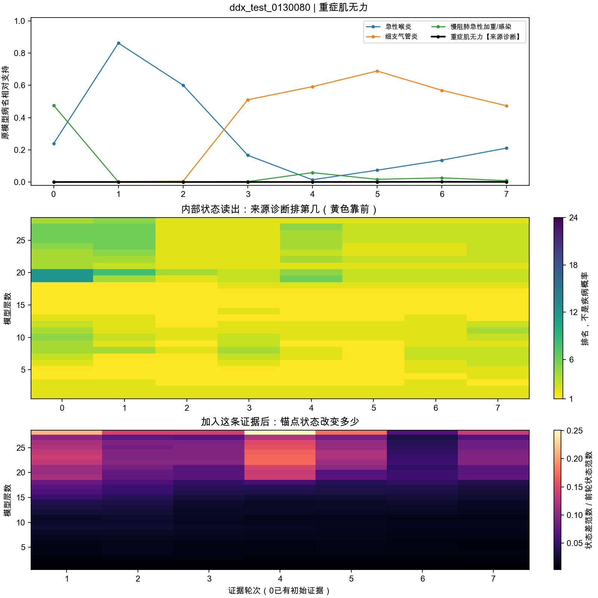

# ddx_test_0130080：重症肌无力

DDxPlus test 原始第130080行（零起始）。轨迹类型：在其他疾病间变动。来源诊断适用于完整病例；中间轮没有逐轮医学标准答案。

| 轮 | 原模型首选（49病） | 来源诊断相对支持 | 第14层读出（24病） | 第21层读出（24病） | 第28层读出（24病） |
|---|---|---:|---|---|---|
| 0 | 慢阻肺急性加重/感染 | 0.0000 | 重症肌无力 | 急性肌张力障碍反应 | 支气管炎 |
| 1 | 急性喉炎 | 0.0000 | 重症肌无力 | 急性肌张力障碍反应 | 急性肌张力障碍反应 |
| 2 | 急性喉炎 | 0.0000 | 重症肌无力 | 急性肌张力障碍反应 | 急性肌张力障碍反应 |
| 3 | 细支气管炎 | 0.0000 | 吉兰-巴雷综合征 | 急性肌张力障碍反应 | 急性肌张力障碍反应 |
| 4 | 细支气管炎 | 0.0000 | 重症肌无力 | 吉兰-巴雷综合征 | 吉兰-巴雷综合征 |
| 5 | 细支气管炎 | 0.0004 | 重症肌无力 | 吉兰-巴雷综合征 | 吉兰-巴雷综合征 |
| 6 | 细支气管炎 | 0.0011 | 重症肌无力 | 吉兰-巴雷综合征 | 吉兰-巴雷综合征 |
| 7 | 细支气管炎 | 0.0006 | 重症肌无力 | 吉兰-巴雷综合征 | 急性肌张力障碍反应 |

## 原始证据

**第0轮** E_172

难以睁开或抬起一侧/双侧眼睑：是

- Do you have a hard time opening/raising one or both eyelids? **Yes**

**第1轮** E_38

下颌疼痛或无力：是

- Do you have pain or weakness in your jaw? **Yes**

**第2轮** E_52

看一个物体时出现两个影像（复视）：是

- Do you have the perception of seeing two images of a single object seen overlapping or adjacent to each other (double vision)? **Yes**

**第3轮** E_84

双臂或双腿无力：是

- Do you feel weakness in both arms and/or both legs? **Yes**

**第4轮** E_66

明显气短或呼吸困难：是

- Are you experiencing shortness of breath or difficulty breathing in a significant way? **Yes**

**第5轮** E_90

疲劳或压力增加时肌无力加重：是

- Do your symptoms of muscle weakness increase with fatigue and/or stress? **Yes**

**第6轮** E_204

近四周出国旅行：否

- Have you traveled out of the country in the last 4 weeks? **No**

**第7轮** E_65

吞咽困难、不适或阻塞感：是

- Do you have difficulty swallowing, or have a feeling of discomfort/blockage when swallowing? **Yes**
