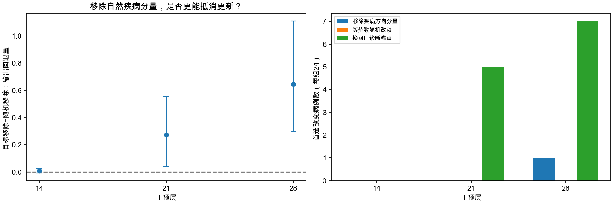

# 自然内部变化，是否真的参与了诊断更新？

**在第28层，移除自然变化中的疾病分量，比同范数随机移除更强地抵消了原输出更新。**

24个新患者、每病1例，在预定中间轮加入一条证据。先测量新旧状态差，再在新证据输入不变的条件下，删掉其中沿疾病读出方向的分量。对照是同等长度的随机正交改动，另有零改动及完整换回旧锚点。第14、21、28层预先指定，共288个条件。本页为首批24例；追加48例复核单独保存。

| 层 | 目标移除比随机移除多造成的回退 | 三层Holm校正p | 目标移除改变首选 |
|---|---|---:|---:|
| 14 | 0.0092 [-0.0076, 0.0285] | 0.3632 | 0/24 |
| 21 | 0.2727 [0.0413, 0.5579] | 0.0578 | 0/24 |
| 28 | 0.6452 [0.2969, 1.1097] | 0.0013 | 1/24 |

回退量以原模型固定疾病对的完整字符串对数分差计算，正值表示抵消原来的更新方向；统计单位是患者。主对比由两种干预相减，零干预用来核验复现。零干预最大log概率误差为0.000000。

本实验只改诊断位置的状态，并保留其他位置及更早层缓存。它检验这一位置、这一方向的作用，不是把新证据从整个网络删除。最后一层两候选同首词元的结构性对照共2例，其病对分差最大变化0.0。

[每个条件](all_conditions.csv) · [每个患者的配对差](paired_patients.csv) · [精确汇总](summary.json)
