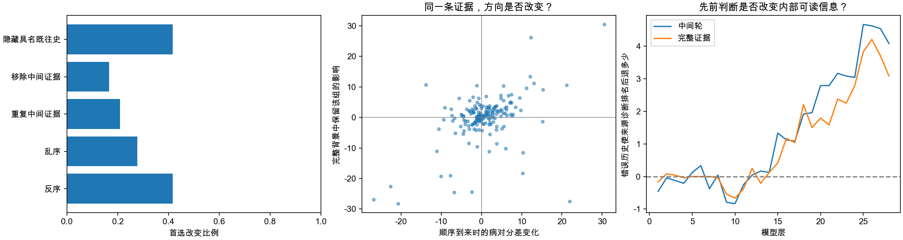

# 证据的作用，是否取决于顺序、背景和先前判断？

## 同样的全部事实，换顺序

72例中，反序后首选改变41.67% [30.56, 52.78]；确定性乱序改变27.78% [18.06, 38.89]。24例中，重复一次中间证据改变20.83% [4.17, 37.50]。重复不引入新事实，但也可能改变强调和位置。

## 同样的当前事实，换先前诊断

24例分别放入正确或预定错误的先前诊断，其他消息结构与重审指令一致。当前事实相同；“正确”指完整病例来源病名，是离线控制。原模型比较49病，内部读出比较冻结24病，因此两种首选切换率分别报告。

| 证据阶段 | 原模型首选因历史不同而改变 | 最后一层读出首选改变 | 错误历史中选中该错误病 | 错误病相对来源病的分差增益 |
|---|---|---|---|---|
| 中间轮 | 91.67% [79.17, 100.00] | 66.67% [45.83, 83.33] | 87.50% [75.00, 100.00] | 48.4897 [42.9442, 54.3344] |
| 完整事实 | 87.50% [75.00, 100.00] | 54.17% [33.33, 75.00] | 83.33% [66.67, 95.83] | 48.2228 [42.3112, 53.8830] |

错误/正确历史之间的病名分差差距，从中间到终点变化为-0.2669 [-6.1982, 5.2438]；负值表示更多事实后历史病名的影响减弱。这是配对描述，未预先规定一定应减弱。

## 同一条证据，放在不同背景里

对24例完整病例逐一删掉每组证据，共208个删组条件。固定比较“来源病”与完整病例下最强的另一病：计算这条证据刚到来时的作用，再计算它在完整背景中的作用。

184次非微小的可比较更新中，有67次方向相反；先患者内求比例再平均为**37.25% [32.61, 42.09]**。病例内两种作用的相关为0.3785 [0.2272, 0.5116]。阈值从1e-4改为1e-3、1e-2的结果见summary.json。这说明模型对某条证据的支持方向依赖其他已知事实；它本身不等于医学推理错误。

原始源码中的一个证据组可能包含多个问题子项，删除单位为整个组。隐藏具名既往史和删组都改变信息内容，不以删减后的来源标签命中率评价临床正确性。无历史条件的消息结构与有历史不同，因此主要历史对比使用正确/错误历史配对。

[顺序](order_cases.csv) · [重复与删组](evidence_controls.csv) · [历史对照](history_cases.csv) · [历史的逐层影响](history_layers.csv) · [每条证据两种背景下的作用](context_group_effects.csv) · [精确汇总](summary.json)
