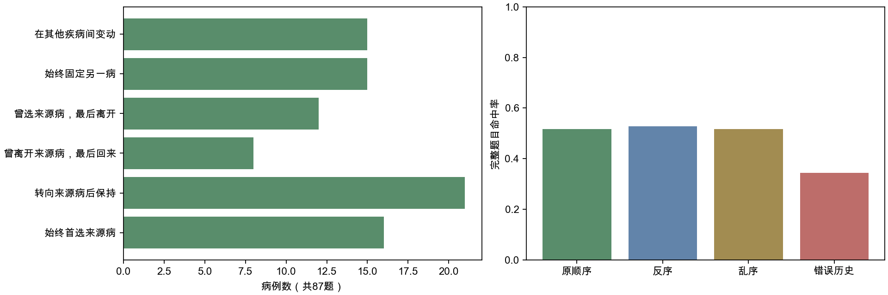

# 换一种病例来源后，医学判断还会怎样变化？

使用MedQA USMLE四选项公开测试集，按预定规则选取87道直接询问诊断的题，84种不同的来源答案。完整题目命中率为**51.72% [41.38, 62.07]**。

原文逐句输入，共693个前缀、606次更新。首选改变107次，单次某病名相对支持变化至少50个百分点101次。至少一次命中来源答案又离开的病例比例为22.99% [13.79, 32.18]。题目并非病人的真实就诊时序；这里模拟证据逐步揭示。

| 完整题目的条件 | 相对原顺序改变首选 | 完整题目命中率 | 配对命中率变化 |
|---|---|---|---|
| reverse | 26.44% [17.24, 35.63] | 52.87% [42.53, 63.22] | 1.15% [-9.20, 11.49] |
| shuffle | 14.94% [8.05, 22.99] | 51.72% [41.35, 62.07] | 0.00% [-8.05, 8.05] |
| wrong_history | 40.23% [29.89, 50.57] | 34.48% [25.29, 44.83] | -17.24% [-27.59, -6.90] |

错误历史中的病名预先从本题非答案选项确定，未按观察结果筛选。其被选中的比例，从原条件16.09% [9.20, 24.14]变为加入历史后42.53% [32.18, 52.87]。模型仍被明确要求依据当前事实重新判断。

## 数据与内部测量的边界

保留原句、原题选项和原答案，没有让模型重写病例。公开原项目为[MedQA](https://github.com/jind11/MedQA)，论文为[What Disease Does This Patient Have?](https://arxiv.org/abs/2009.13081)。本地文件通过公开镜像取得，完整哈希与逐题筛选理由见[data/external_medqa](../../data/external_medqa/provenance.json)。运行前已修复关系从句被误当提问的分割错误，弃用版本没有运行模型。

每轮保存全部28层内部状态及锚点分头注意力。本阶段只量化状态改变，不把DDxPlus的24类读出器套到不同的MedQA病名上；疾病方向的逐层结论来自独立DDxPlus分析。MedQA为考试病例，四选项准确率与DDxPlus49病准确率分别报告。逆序保留所有事实句，但可能改变语言连贯性，因此不能把顺序效应全部归为医学偏见。

[全部病例](CASE_ATLAS.md) · [逐句结果](prefix_trajectories.csv) · [条件对照](controls.csv) · [每层状态](internal_state_change.csv) · [精确汇总](summary.json)
