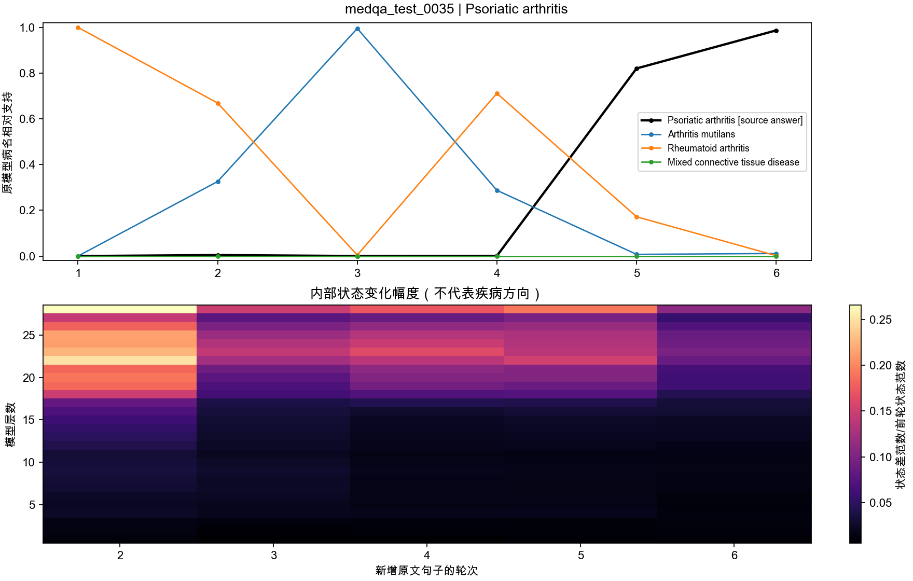

# medqa_test_0035：Psoriatic arthritis

来源：MedQA四选项test，第35行（零起始）。来源答案只用于完整题目评价。路径：转向来源病后保持。下图没有用DDxPlus探针解码MedQA病名。

Which of the following is the most likely diagnosis?

| 轮 | 原模型首选 | 来源答案支持 | 本轮新增原文 |
|---|---|---:|---|
| 1 | Rheumatoid arthritis | 0.0000 | A 67-year-old man who was diagnosed with arthritis 16 years ago presents with right knee swelling and pain. |
| 2 | Rheumatoid arthritis | 0.0045 | His left knee was swollen a few weeks ago, but now with both joints affected, he has difficulty walking and feels frustrated. |
| 3 | Arthritis mutilans | 0.0002 | He also has back pain which makes it extremely difficult to move around and be active during the day. |
| 4 | Rheumatoid arthritis | 0.0009 | He says his pain significantly improves with rest. |
| 5 | Psoriatic arthritis | 0.8205 | He also suffers from dandruff for which he uses special shampoos. |
| 6 | Psoriatic arthritis | 0.9869 | Physical examination is notable for pitting of his nails. |

| 完整题目控制 | 原模型首选 | 来源答案支持改变 |
|---|---|---:|
| reverse | Rheumatoid arthritis | -0.9431 |
| shuffle | Arthritis mutilans | -0.5529 |
| wrong_history | Arthritis mutilans | -0.9869 |

原题选项：{"A": "Psoriatic arthritis", "B": "Arthritis mutilans", "C": "Rheumatoid arthritis", "D": "Mixed connective tissue disease"}
