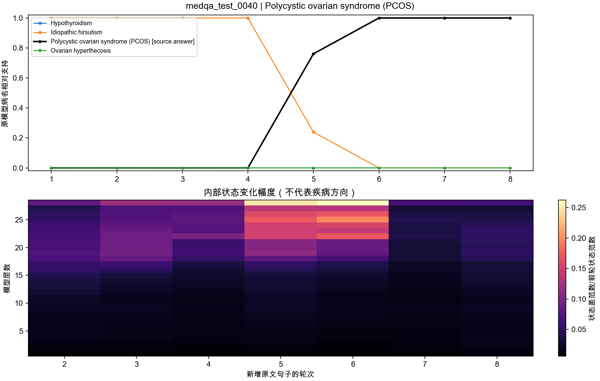

# medqa_test_0040：Polycystic ovarian syndrome (PCOS)

来源：MedQA四选项test，第40行（零起始）。来源答案只用于完整题目评价。路径：转向来源病后保持。下图没有用DDxPlus探针解码MedQA病名。

What is the most likely diagnosis of this patient?

| 轮 | 原模型首选 | 来源答案支持 | 本轮新增原文 |
|---|---|---:|---|
| 1 | Idiopathic hirsutism | 0.0000 | A 27-year-old woman presents to the office with concerns about her long struggle with her physical appearance since adolescence. |
| 2 | Idiopathic hirsutism | 0.0000 | She says she has always been "large" and was constantly targeted by her classmates and coworkers for being so. |
| 3 | Idiopathic hirsutism | 0.0000 | Her main concern at the moment is her acne and unwanted facial hair on her upper lip, for which she often visits a local spa. |
| 4 | Idiopathic hirsutism | 0.0002 | She has tried numerous diet plans, exercise regimens, and cosmetic products with little to no effect. |
| 5 | Polycystic ovarian syndrome (PCOS) | 0.7612 | Recently, she underwent a glucose tolerance test that showed a plasma glucose level of 160 mg/dL (8.9 mmol/L) after 2 hours of a 75 g dose of oral glucose. |
| 6 | Polycystic ovarian syndrome (PCOS) | 1.0000 | She has a family history of type 2 diabetes mellitus and a menstrual cycle that occurs every 45 days. |
| 7 | Polycystic ovarian syndrome (PCOS) | 0.9999 | Her pulse is 72/min and the blood pressure is 138/80 mm Hg. |
| 8 | Polycystic ovarian syndrome (PCOS) | 1.0000 | On physical examination, her height is 160 cm (5 ft 3 in) and her weight is 85 kg (187 lb), and she has severe inflammatory acne over the cheeks and forehead and dark coarse hairs on the back. |

| 完整题目控制 | 原模型首选 | 来源答案支持改变 |
|---|---|---:|
| reverse | Idiopathic hirsutism | -0.7187 |
| shuffle | Polycystic ovarian syndrome (PCOS) | -0.1108 |
| wrong_history | Polycystic ovarian syndrome (PCOS) | -0.0015 |

原题选项：{"A": "Hypothyroidism", "B": "Idiopathic hirsutism", "C": "Polycystic ovarian syndrome (PCOS)", "D": "Ovarian hyperthecosis"}
