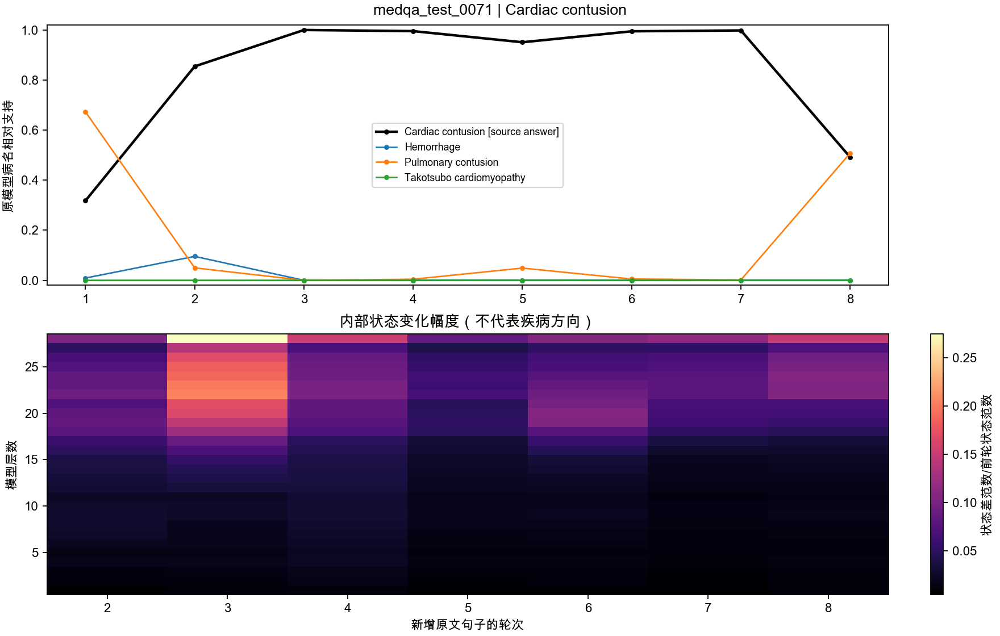

# medqa_test_0071：Cardiac contusion

来源：MedQA四选项test，第71行（零起始）。来源答案只用于完整题目评价。路径：曾选来源病，最后离开。下图没有用DDxPlus探针解码MedQA病名。

Which of the following is the most likely diagnosis?

| 轮 | 原模型首选 | 来源答案支持 | 本轮新增原文 |
|---|---|---:|---|
| 1 | Pulmonary contusion | 0.3179 | A 27-year-old man presents to the emergency department after a motor vehicle collision. |
| 2 | Cardiac contusion | 0.8546 | The patient was the front seat unrestrained driver in a head on collision. |
| 3 | Cardiac contusion | 1.0000 | The patient’s echocardiogram (ECG) is notable only for sinus tachycardia. |
| 4 | Cardiac contusion | 0.9955 | His temperature is 99.5°F (37.5°C), blood pressure is 107/58 mmHg, pulse is 120/min, respirations are 17/min, and oxygen saturation is 98% on room air. |
| 5 | Cardiac contusion | 0.9511 | The patient is given 2 liters of Ringer lactate solution and morphine. |
| 6 | Cardiac contusion | 0.9948 | Initial workup demonstrates that the patient’s pulmonary capillary wedge pressure and troponins are elevated. |
| 7 | Cardiac contusion | 0.9982 | The patient is currently complaining of chest pain. |
| 8 | Pulmonary contusion | 0.4921 | Physical exam is notable for an uncomfortable young man with bruising over his chest wall. |

| 完整题目控制 | 原模型首选 | 来源答案支持改变 |
|---|---|---:|
| reverse | Cardiac contusion | +0.4442 |
| shuffle | Pulmonary contusion | -0.4730 |
| wrong_history | Pulmonary contusion | -0.3492 |

原题选项：{"A": "Cardiac contusion", "B": "Hemorrhage", "C": "Pulmonary contusion", "D": "Takotsubo cardiomyopathy"}
