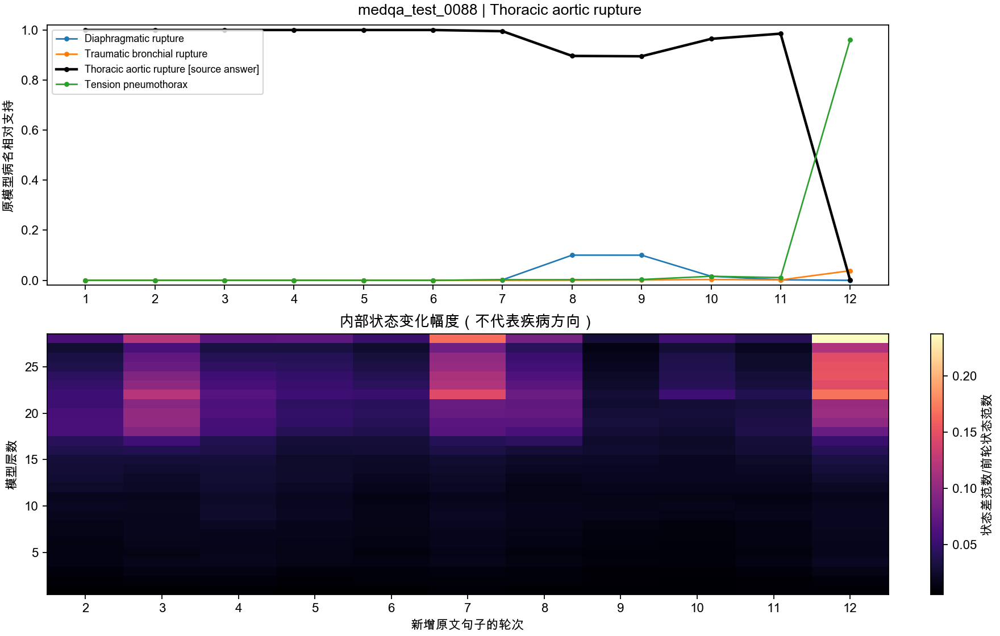

# medqa_test_0088：Thoracic aortic rupture

来源：MedQA四选项test，第88行（零起始）。来源答案只用于完整题目评价。路径：曾选来源病，最后离开。下图没有用DDxPlus探针解码MedQA病名。

Which of the following is the most likely diagnosis?

| 轮 | 原模型首选 | 来源答案支持 | 本轮新增原文 |
|---|---|---:|---|
| 1 | Thoracic aortic rupture | 1.0000 | A 26-year-old woman is brought to the emergency department 20 minutes after being involved in a high-speed motor vehicle collision in which she was a restrained passenger. |
| 2 | Thoracic aortic rupture | 1.0000 | On arrival, she is lethargic and incoherent. |
| 3 | Thoracic aortic rupture | 1.0000 | She has severe facial lacerations and is in respiratory distress. |
| 4 | Thoracic aortic rupture | 1.0000 | Her pulse is 130/min, respirations are 29/min, and blood pressure is 90/58 mm Hg. |
| 5 | Thoracic aortic rupture | 1.0000 | Pulse oximetry on room air shows an oxygen saturation of 70%. |
| 6 | Thoracic aortic rupture | 1.0000 | Examination shows multiple facial lacerations. |
| 7 | Thoracic aortic rupture | 0.9952 | There is dullness to percussion and decreased breath sounds over the left lung base. |
| 8 | Thoracic aortic rupture | 0.8964 | Abdominal examination shows diffuse tenderness with no guarding or rebound. |
| 9 | Thoracic aortic rupture | 0.8950 | Bowel sounds are normal. |
| 10 | Thoracic aortic rupture | 0.9646 | The remainder of the examination shows no abnormalities. |
| 11 | Thoracic aortic rupture | 0.9854 | Her hemoglobin concentration is 12.1 g/dL. |
| 12 | Tension pneumothorax | 0.0005 | An x-ray of the chest shows a fractured left second rib, depression of the left mainstem bronchus, deviation of the nasogastric tube to the right, and a widened mediastinum. |

| 完整题目控制 | 原模型首选 | 来源答案支持改变 |
|---|---|---:|
| reverse | Tension pneumothorax | -0.0005 |
| shuffle | Tension pneumothorax | -0.0005 |
| wrong_history | Tension pneumothorax | -0.0005 |

原题选项：{"A": "Diaphragmatic rupture", "B": "Traumatic bronchial rupture", "C": "Thoracic aortic rupture", "D": "Tension pneumothorax"}
