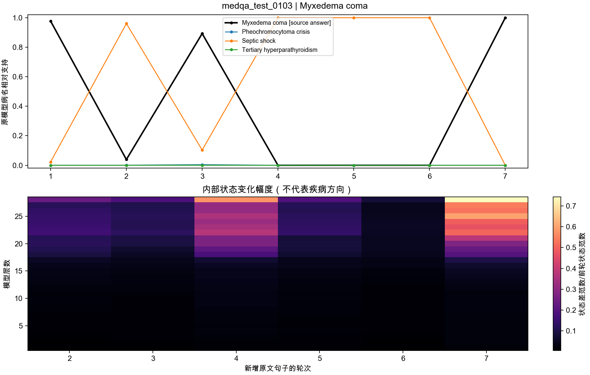

# medqa_test_0103：Myxedema coma

来源：MedQA四选项test，第103行（零起始）。来源答案只用于完整题目评价。路径：曾离开来源病，最后回来。下图没有用DDxPlus探针解码MedQA病名。

Which of the following is the most likely diagnosis in this patient?

| 轮 | 原模型首选 | 来源答案支持 | 本轮新增原文 |
|---|---|---:|---|
| 1 | Myxedema coma | 0.9769 | A 75-year-old woman is brought by a patrolman to the emergency department because of altered mental status. |
| 2 | Septic shock | 0.0390 | She was found wandering next to the highway. |
| 3 | Myxedema coma | 0.8924 | The patient was unable to answer questions and collapsed in transit. |
| 4 | Septic shock | 0.0000 | Her vitals are: temperature, 33.0°C (91.4°F); pulse, 40/min; respirations,12/min; blood pressure, 80/50 mm Hg; and oxygen saturation, 85% on room air. |
| 5 | Septic shock | 0.0002 | Physical examination shows decorticate posturing, incomprehensible speech, eyes opening to pain, dry hair, coarse and waxy skin, and non-pitting edema around the face and all extremities. |
| 6 | Septic shock | 0.0001 | Electrocardiogram shows sinus bradycardia. |
| 7 | Myxedema coma | 1.0000 | Laboratory studies show:
Calcium 9.0 mg/dL
Hematocrit (female) 34%
Potassium 4.0 mEq/L
Sodium 120 mEq/L
TSH 110.0 µU/mL
Thyroxine (T4) 1.2 µg/dL
Triiodothyronine (T3) 70 ng/dL |

| 完整题目控制 | 原模型首选 | 来源答案支持改变 |
|---|---|---:|
| reverse | Myxedema coma | -0.0000 |
| shuffle | Myxedema coma | -0.0000 |
| wrong_history | Myxedema coma | -0.0000 |

原题选项：{"A": "Myxedema coma", "B": "Pheochromocytoma crisis", "C": "Septic shock", "D": "Tertiary hyperparathyroidism"}
