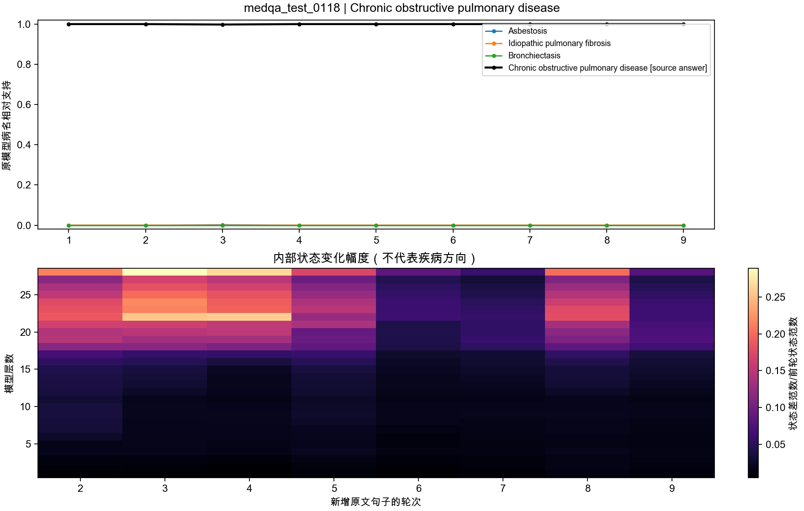

# medqa_test_0118：Chronic obstructive pulmonary disease

来源：MedQA四选项test，第118行（零起始）。来源答案只用于完整题目评价。路径：始终首选来源病。下图没有用DDxPlus探针解码MedQA病名。

Which of the following is the most likely diagnosis?

| 轮 | 原模型首选 | 来源答案支持 | 本轮新增原文 |
|---|---|---:|---|
| 1 | Chronic obstructive pulmonary disease | 1.0000 | A 56-year-old man comes to the clinic for a check-up. |
| 2 | Chronic obstructive pulmonary disease | 1.0000 | He presents with a 1-year history of worsening shortness of breath and weight loss. |
| 3 | Chronic obstructive pulmonary disease | 0.9978 | He is a former construction worker, and worked in a steel mill when he was in high school. |
| 4 | Chronic obstructive pulmonary disease | 1.0000 | He is an active smoker with a 36-pack-year smoking history. |
| 5 | Chronic obstructive pulmonary disease | 1.0000 | The blood pressure is 130/78 mm Hg, pulse rate is 90/min, respiratory rate is 17/min, and the BMI is 31 kg/m2. |
| 6 | Chronic obstructive pulmonary disease | 1.0000 | The patient is afebrile and the oxygen saturation at rest is 95% on room air. |
| 7 | Chronic obstructive pulmonary disease | 1.0000 | The pulmonary examination reveals a mildly prolonged expiratory phase, and no wheezing or crackles are auscultated. |
| 8 | Chronic obstructive pulmonary disease | 1.0000 | A pulmonary function test is recommended for the patient, and 2 weeks later he returns with a report that shows an FEV1/FVC ratio of 60% and FEV1 of 50% of the predicted value. |
| 9 | Chronic obstructive pulmonary disease | 1.0000 | The lung volumes show a total lung capacity of 110% of predicted value, a residual volume of 115% of predicted value, and a DLCO of 60% of predicted value. |

| 完整题目控制 | 原模型首选 | 来源答案支持改变 |
|---|---|---:|
| reverse | Chronic obstructive pulmonary disease | -0.0000 |
| shuffle | Chronic obstructive pulmonary disease | -0.0000 |
| wrong_history | Chronic obstructive pulmonary disease | -0.0000 |

原题选项：{"A": "Asbestosis", "B": "Idiopathic pulmonary fibrosis", "C": "Bronchiectasis", "D": "Chronic obstructive pulmonary disease"}
