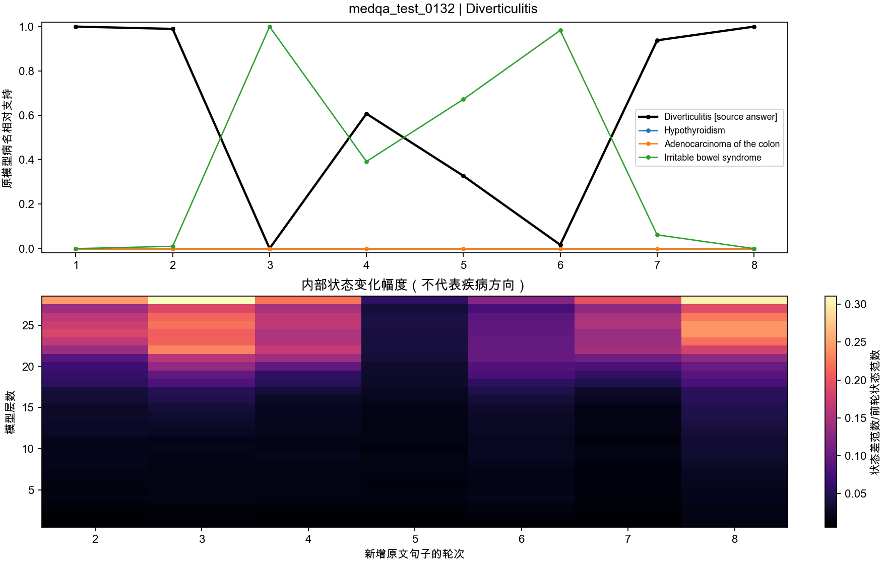

# medqa_test_0132：Diverticulitis

来源：MedQA四选项test，第132行（零起始）。来源答案只用于完整题目评价。路径：曾离开来源病，最后回来。下图没有用DDxPlus探针解码MedQA病名。

Which of the following is the most likely diagnosis in this patient?

| 轮 | 原模型首选 | 来源答案支持 | 本轮新增原文 |
|---|---|---:|---|
| 1 | Diverticulitis | 1.0000 | A 68-year-old woman presents with left lower quadrant pain that worsens with defecation. |
| 2 | Diverticulitis | 0.9897 | She describes the pain as 'crampy'. |
| 3 | Irritable bowel syndrome | 0.0003 | She also says she has suffered from mild constipation for the past few years. |
| 4 | Diverticulitis | 0.6077 | The patient denies any recent weight change or urinary symptoms. |
| 5 | Irritable bowel syndrome | 0.3277 | Her last menstrual period was 16 years ago. |
| 6 | Irritable bowel syndrome | 0.0169 | Her body temperature is 37.8°C (100.0°F), pulse is 102/min, respiratory rate is 16/min, and blood pressure is 133/87 mm Hg. |
| 7 | Diverticulitis | 0.9381 | On physical examination, tenderness to palpation in the left lower quadrant is present. |
| 8 | Diverticulitis | 1.0000 | The laboratory studies are presented as follows:
Hemoglobin 13.2 mg/dL
Hematocrit 48%
Leukocyte count 16,000/mm³
Neutrophils 89%
Bands 5%
Eosinophils 0%
Basophils 0%
Lymphocytes 11%
Monocytes 0%
Platelet count 380,000/mm³ |

| 完整题目控制 | 原模型首选 | 来源答案支持改变 |
|---|---|---:|
| reverse | Diverticulitis | -0.0103 |
| shuffle | Diverticulitis | -0.0000 |
| wrong_history | Diverticulitis | -0.0110 |

原题选项：{"A": "Diverticulitis", "B": "Hypothyroidism", "C": "Adenocarcinoma of the colon", "D": "Irritable bowel syndrome"}
