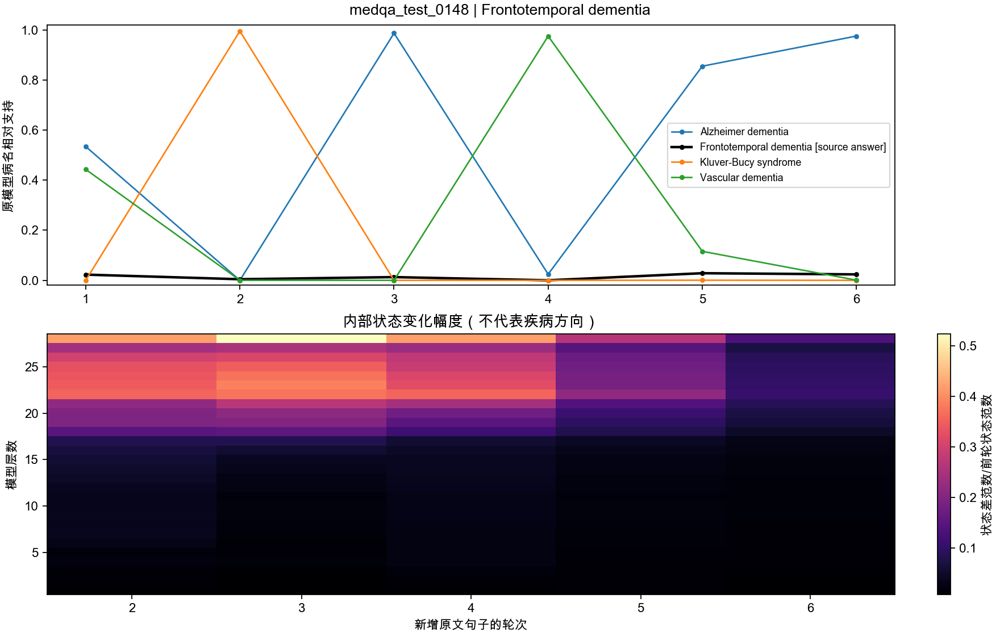

# medqa_test_0148：Frontotemporal dementia

来源：MedQA四选项test，第148行（零起始）。来源答案只用于完整题目评价。路径：在其他疾病间变动。下图没有用DDxPlus探针解码MedQA病名。

Which of the following is the most likely diagnosis?

| 轮 | 原模型首选 | 来源答案支持 | 本轮新增原文 |
|---|---|---:|---|
| 1 | Alzheimer dementia | 0.0228 | A 65-year-old man presents to his primary care physician for a change in his behavior over the past few months. |
| 2 | Kluver-Bucy syndrome | 0.0043 | Initially, the patient was noted to be behaving inappropriately including using foul language and grabbing people unexpectedly. |
| 3 | Alzheimer dementia | 0.0128 | This has progressed to a worsening of his memory and trouble caring for himself. |
| 4 | Vascular dementia | 0.0000 | His temperature is 98.1°F (36.7°C), blood pressure is 162/103 mmHg, pulse is 83/min, respirations are 13/min, and oxygen saturation is 98% on room air. |
| 5 | Alzheimer dementia | 0.0284 | Physical exam is notable for an elderly man who laughs inappropriately at times and who is a poor historian. |
| 6 | Alzheimer dementia | 0.0237 | When he is engaged in conversation, he exhibits word finding difficulty and is rather inattentive. |

| 完整题目控制 | 原模型首选 | 来源答案支持改变 |
|---|---|---:|
| reverse | Frontotemporal dementia | +0.6857 |
| shuffle | Alzheimer dementia | +0.0882 |
| wrong_history | Vascular dementia | -0.0157 |

原题选项：{"A": "Alzheimer dementia", "B": "Frontotemporal dementia", "C": "Kluver-Bucy syndrome", "D": "Vascular dementia"}
