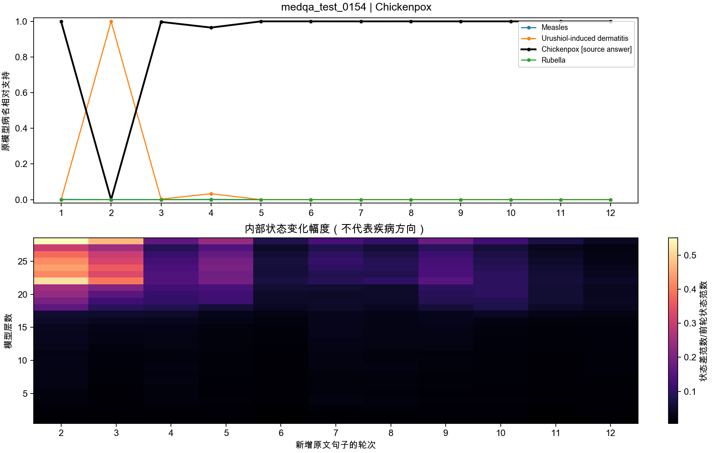

# medqa_test_0154：Chickenpox

来源：MedQA四选项test，第154行（零起始）。来源答案只用于完整题目评价。路径：曾离开来源病，最后回来。下图没有用DDxPlus探针解码MedQA病名。

Which of the following is the most likely diagnosis?

| 轮 | 原模型首选 | 来源答案支持 | 本轮新增原文 |
|---|---|---:|---|
| 1 | Chickenpox | 0.9986 | A 4-year-old boy is brought to the physician because of a generalized rash for 3 days. |
| 2 | Urushiol-induced dermatitis | 0.0000 | During this period, he has had severe itching and was not able to sleep well. |
| 3 | Chickenpox | 0.9971 | He has also had fever, headache, and some muscle pain. |
| 4 | Chickenpox | 0.9652 | Five days ago, he had a runny nose which subsided with over-the-counter medications. |
| 5 | Chickenpox | 1.0000 | He returned from a camping trip 1 week ago. |
| 6 | Chickenpox | 1.0000 | He attends a daycare center. |
| 7 | Chickenpox | 0.9999 | The patient is at the 55th percentile for height and at the 50th percentile for weight. |
| 8 | Chickenpox | 1.0000 | His temperature is 38.2°C (100.7°F), pulse is 97/min, and blood pressure is 96/60 mm Hg. |
| 9 | Chickenpox | 1.0000 | Examination of the skin shows several macules, papules, and crusted lesions over his face, trunk, and extremities. |
| 10 | Chickenpox | 1.0000 | There are a few fluid-filled vesicles over his abdomen and back. |
| 11 | Chickenpox | 1.0000 | There is no cervical lymphadenopathy. |
| 12 | Chickenpox | 1.0000 | The remainder of the examination shows no abnormalities. |

| 完整题目控制 | 原模型首选 | 来源答案支持改变 |
|---|---|---:|
| reverse | Chickenpox | -0.0003 |
| shuffle | Chickenpox | -0.0000 |
| wrong_history | Chickenpox | -0.0000 |

原题选项：{"A": "Measles", "B": "Urushiol-induced dermatitis", "C": "Chickenpox", "D": "Rubella"}
