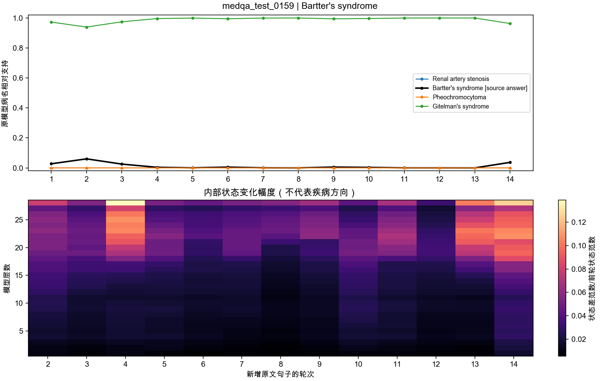

# medqa_test_0159：Bartter's syndrome

来源：MedQA四选项test，第159行（零起始）。来源答案只用于完整题目评价。路径：始终固定另一病。下图没有用DDxPlus探针解码MedQA病名。

What is the most likely diagnosis?

| 轮 | 原模型首选 | 来源答案支持 | 本轮新增原文 |
|---|---|---:|---|
| 1 | Gitelman's syndrome | 0.0276 | A 9-year-old boy is brought to a physician by his mother for evaluation of generalized weakness, increased urination, and increased thirst. |
| 2 | Gitelman's syndrome | 0.0605 | The mother mentions that her boy is always tired, and seems to be getting worse. |
| 3 | Gitelman's syndrome | 0.0255 | He prefers watching television rather than going out and playing with other kids. |
| 4 | Gitelman's syndrome | 0.0041 | Furthermore, he has had frequent episodes of constipation since birth. |
| 5 | Gitelman's syndrome | 0.0006 | Except for frequent cravings for salty foods, the boy eats a regular diet. |
| 6 | Gitelman's syndrome | 0.0053 | The patient was delivered healthy and is fully immunized. |
| 7 | Gitelman's syndrome | 0.0007 | The medical history is unremarkable, and he takes no medications. |
| 8 | Gitelman's syndrome | 0.0001 | He has no siblings. |
| 9 | Gitelman's syndrome | 0.0056 | His father is a banker and his mother is a librarian. |
| 10 | Gitelman's syndrome | 0.0036 | The pulse is 90/min, the blood pressure is 110/75 mm Hg, and the respiratory rate is 15/min. |
| 11 | Gitelman's syndrome | 0.0004 | He is in the bottom 10th percentile for height and weight according to his age. |
| 12 | Gitelman's syndrome | 0.0003 | The remainder of the physical examination is unremarkable. |
| 13 | Gitelman's syndrome | 0.0001 | He recently had a urinalysis that showed elevated urinary calcium excretion. |
| 14 | Gitelman's syndrome | 0.0371 | Additional lab testing results are as follows:
Serum electrolytes
Sodium 135 mEq/L
Potassium 3.2 mEq/L
Chloride 95 mEq/L
Plasma renin activity 10 ng/mL/hr (normal, 0.5–3.3 ng/mL/hr)
Plasma aldosterone concentration 20 ng/dL (normal, 2–9 ng/dL) |

| 完整题目控制 | 原模型首选 | 来源答案支持改变 |
|---|---|---:|
| reverse | Bartter's syndrome | +0.8644 |
| shuffle | Gitelman's syndrome | -0.0352 |
| wrong_history | Gitelman's syndrome | -0.0371 |

原题选项：{"A": "Renal artery stenosis", "B": "Bartter's syndrome", "C": "Pheochromocytoma", "D": "Gitelman's syndrome"}
