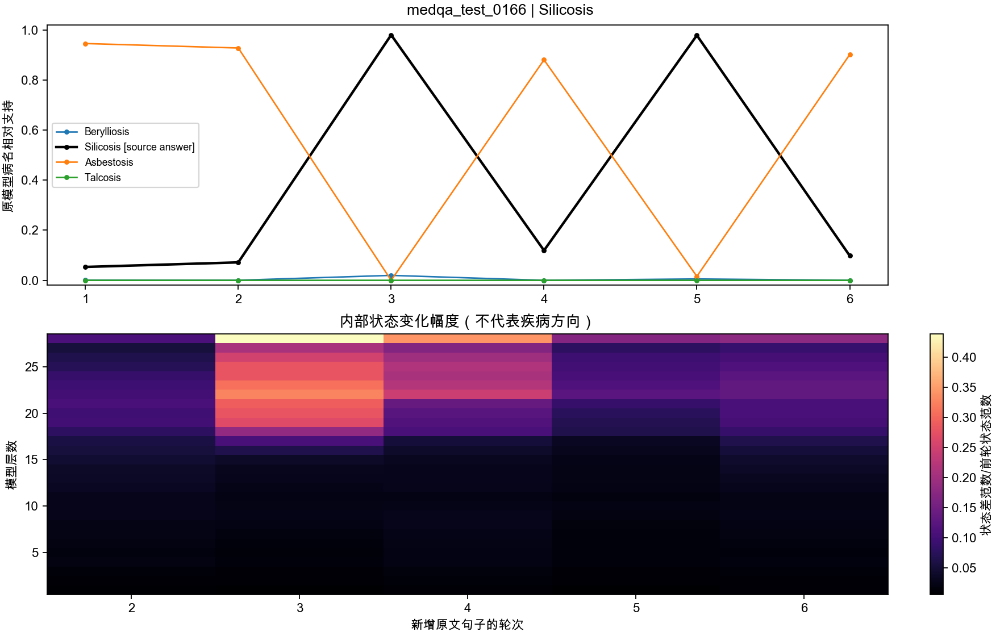

# medqa_test_0166：Silicosis

来源：MedQA四选项test，第166行（零起始）。来源答案只用于完整题目评价。路径：曾选来源病，最后离开。下图没有用DDxPlus探针解码MedQA病名。

What is the most likely diagnosis?

| 轮 | 原模型首选 | 来源答案支持 | 本轮新增原文 |
|---|---|---:|---|
| 1 | Asbestosis | 0.0534 | A 60-year-old man presents to the office for shortness of breath. |
| 2 | Asbestosis | 0.0716 | The shortness of breath started a year ago and is exacerbated by physical activity. |
| 3 | Silicosis | 0.9803 | He has been working in the glass manufacturing industry for 20 years. |
| 4 | Asbestosis | 0.1193 | His vital signs include: heart rate 72/min, respiratory rate 30/min, and blood pressure 130/80 mm Hg. |
| 5 | Silicosis | 0.9787 | On physical exam, there are diminished respiratory sounds on both sides. |
| 6 | Asbestosis | 0.0982 | On the chest radiograph, interstitial fibrosis with reticulonodular infiltrate is found on both sides, and there is also an eggshell calcification of multiple adenopathies. |

| 完整题目控制 | 原模型首选 | 来源答案支持改变 |
|---|---|---:|
| reverse | Silicosis | +0.7380 |
| shuffle | Silicosis | +0.5098 |
| wrong_history | Silicosis | +0.8637 |

原题选项：{"A": "Berylliosis", "B": "Silicosis", "C": "Asbestosis", "D": "Talcosis"}
