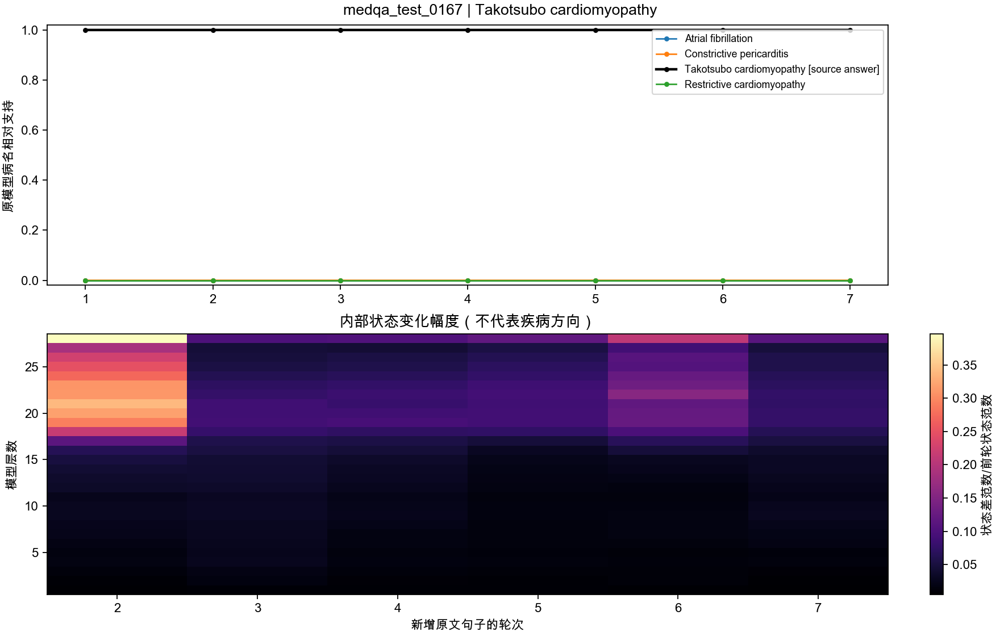

# medqa_test_0167：Takotsubo cardiomyopathy

来源：MedQA四选项test，第167行（零起始）。来源答案只用于完整题目评价。路径：始终首选来源病。下图没有用DDxPlus探针解码MedQA病名。

Which of the following is the most likely diagnosis?

| 轮 | 原模型首选 | 来源答案支持 | 本轮新增原文 |
|---|---|---:|---|
| 1 | Takotsubo cardiomyopathy | 1.0000 | A 43-year-old woman is brought to the emergency department by her brother for severe chest pain. |
| 2 | Takotsubo cardiomyopathy | 1.0000 | The patient recently lost her husband in a car accident and is still extremely shocked by the event. |
| 3 | Takotsubo cardiomyopathy | 1.0000 | On physical examination, her blood pressure is 105/67 mm Hg, the heart rate is 96/min and regular, breathing rate is 23/min, and the pulse oximetry is 96%. |
| 4 | Takotsubo cardiomyopathy | 1.0000 | An S3 heart sound and rales in the lower right and left lung lobes are heard. |
| 5 | Takotsubo cardiomyopathy | 1.0000 | A 12-lead ECG shows no significant findings. |
| 6 | Takotsubo cardiomyopathy | 1.0000 | Echocardiography shows an enlarged left ventricle and left atrium. |
| 7 | Takotsubo cardiomyopathy | 1.0000 | The patient is stabilized and informed about the diagnosis and possible treatment options. |

| 完整题目控制 | 原模型首选 | 来源答案支持改变 |
|---|---|---:|
| reverse | Takotsubo cardiomyopathy | +0.0000 |
| shuffle | Takotsubo cardiomyopathy | +0.0000 |
| wrong_history | Takotsubo cardiomyopathy | -0.0000 |

原题选项：{"A": "Atrial fibrillation", "B": "Constrictive pericarditis", "C": "Takotsubo cardiomyopathy", "D": "Restrictive cardiomyopathy"}
