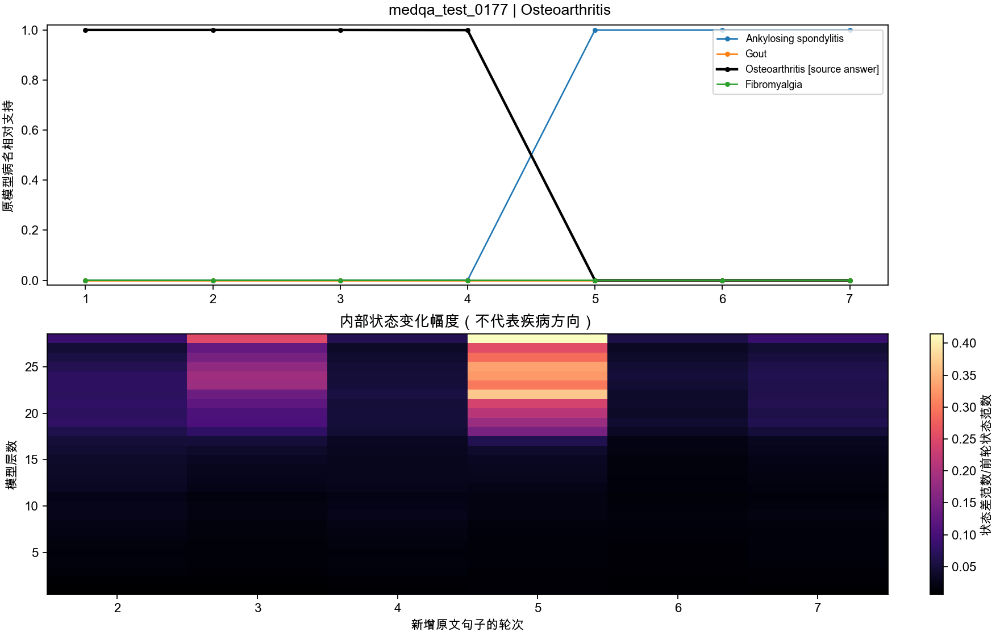

# medqa_test_0177：Osteoarthritis

来源：MedQA四选项test，第177行（零起始）。来源答案只用于完整题目评价。路径：曾选来源病，最后离开。下图没有用DDxPlus探针解码MedQA病名。

Which of the following is the most likely diagnosis?

| 轮 | 原模型首选 | 来源答案支持 | 本轮新增原文 |
|---|---|---:|---|
| 1 | Osteoarthritis | 1.0000 | A 55-year-old man presents to a rheumatologist with bilateral wrist and knee pain that has been present for the last 10 years. |
| 2 | Osteoarthritis | 1.0000 | The patient was a professional athlete who retired at age 50. |
| 3 | Osteoarthritis | 0.9999 | He also notes morning stiffness in his joints that lasts approx. 50 minutes. |
| 4 | Osteoarthritis | 0.9994 | He denies joint swelling, color changes in his digits, dryness of mucous membranes, and constitutional symptoms such as fever and chills. |
| 5 | Ankylosing spondylitis | 0.0000 | On physical exam, the physician notes several non-tender nodules on the left 1st, 3rd, and 4th distal interphalangeal joints. |
| 6 | Ankylosing spondylitis | 0.0000 | There is also tenderness with palpation at the base of both thumbs. |
| 7 | Ankylosing spondylitis | 0.0000 | The patient’s knees are enlarged, bilaterally, and he has pain and crepitus on passive range of motion. |

| 完整题目控制 | 原模型首选 | 来源答案支持改变 |
|---|---|---:|
| reverse | Osteoarthritis | +0.9511 |
| shuffle | Ankylosing spondylitis | +0.0145 |
| wrong_history | Osteoarthritis | +0.8463 |

原题选项：{"A": "Ankylosing spondylitis", "B": "Gout", "C": "Osteoarthritis", "D": "Fibromyalgia"}
