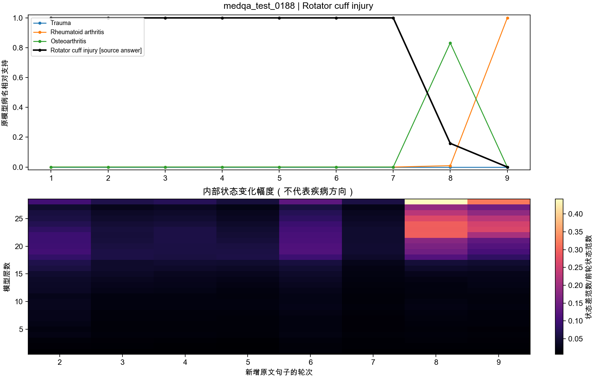

# medqa_test_0188：Rotator cuff injury

来源：MedQA四选项test，第188行（零起始）。来源答案只用于完整题目评价。路径：曾选来源病，最后离开。下图没有用DDxPlus探针解码MedQA病名。

What is the most likely diagnosis?

| 轮 | 原模型首选 | 来源答案支持 | 本轮新增原文 |
|---|---|---:|---|
| 1 | Rotator cuff injury | 1.0000 | A 27-year-old man presents to the emergency room complaining of left shoulder pain for several weeks. |
| 2 | Rotator cuff injury | 1.0000 | He says that the pain often worsens when he tries to sleep on his left side. |
| 3 | Rotator cuff injury | 1.0000 | Although he tried several pain medications, none of the pain medications helped. |
| 4 | Rotator cuff injury | 1.0000 | He is an amateur tennis player who practices on weekends. |
| 5 | Rotator cuff injury | 1.0000 | He denies any trauma during his practice sessions. |
| 6 | Rotator cuff injury | 1.0000 | On examination of the shoulder joint, severe tenderness was present localized to the greater tuberosity of the left shoulder joint along with biceps tendon tenderness over the bicipital groove. |
| 7 | Rotator cuff injury | 1.0000 | The range of motion was limited to the left side. |
| 8 | Osteoarthritis | 0.1588 | An X-ray of the joint showed narrowing of the acromiohumeral space with sclerosis and spurring of the acromion. |
| 9 | Rheumatoid arthritis | 0.0003 | Routine blood test results are normal except for the rheumatoid factor, which is positive. |

| 完整题目控制 | 原模型首选 | 来源答案支持改变 |
|---|---|---:|
| reverse | Rheumatoid arthritis | +0.0004 |
| shuffle | Rotator cuff injury | +0.5848 |
| wrong_history | Rheumatoid arthritis | -0.0002 |

原题选项：{"A": "Trauma", "B": "Rheumatoid arthritis", "C": "Osteoarthritis", "D": "Rotator cuff injury"}
