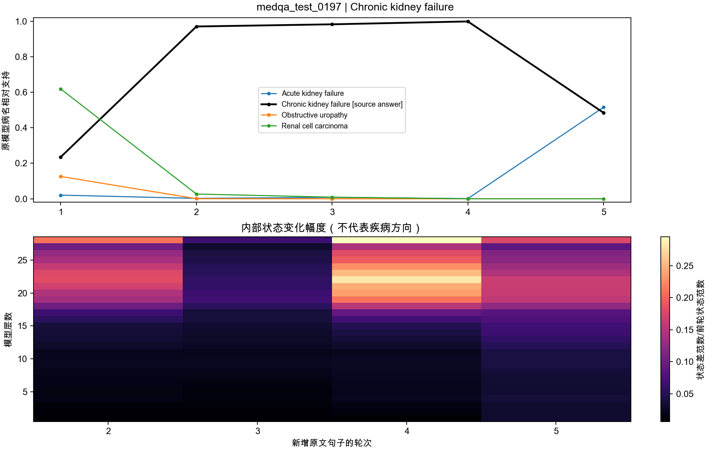

# medqa_test_0197：Chronic kidney failure

来源：MedQA四选项test，第197行（零起始）。来源答案只用于完整题目评价。路径：曾选来源病，最后离开。下图没有用DDxPlus探针解码MedQA病名。

Which of the following is the most likely diagnosis?

| 轮 | 原模型首选 | 来源答案支持 | 本轮新增原文 |
|---|---|---:|---|
| 1 | Renal cell carcinoma | 0.2349 | A 40-year-old woman presents to her primary care physician for a checkup. |
| 2 | Chronic kidney failure | 0.9706 | She has felt weaker lately and has lost some weight. |
| 3 | Chronic kidney failure | 0.9829 | She denies any urinary issues. |
| 4 | Chronic kidney failure | 0.9990 | Her BUN at her last visit 4 months ago was 45 mg/dL, and her creatinine was 2.0 mg/dL. |
| 5 | Acute kidney failure | 0.4844 | Her laboratory studies this visit are seen below:

Hemoglobin: 8 g/dL
Hematocrit: 29%
Leukocyte count: 9,500/mm^3 with normal differential
Platelet count: 197,000/mm^3

Serum:
Na+: 139 mEq/L
Cl-: 100 mEq/L
K+: 5.9 mEq/L
HCO3-: 17 mEq/L
BUN: 59 mg/dL
Glucose: 99 mg/dL
Creatinine: 2.3 mg/dL
Ca2+: 9.0 mg/dL |

| 完整题目控制 | 原模型首选 | 来源答案支持改变 |
|---|---|---:|
| reverse | Acute kidney failure | -0.4063 |
| shuffle | Chronic kidney failure | +0.5102 |
| wrong_history | Acute kidney failure | -0.4557 |

原题选项：{"A": "Acute kidney failure", "B": "Chronic kidney failure", "C": "Obstructive uropathy", "D": "Renal cell carcinoma"}
