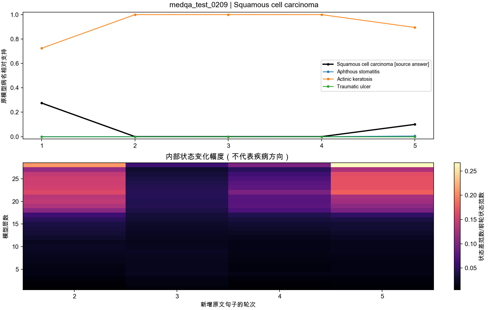

# medqa_test_0209：Squamous cell carcinoma

来源：MedQA四选项test，第209行（零起始）。来源答案只用于完整题目评价。路径：始终固定另一病。下图没有用DDxPlus探针解码MedQA病名。

Which of the following is the most likely diagnosis?

| 轮 | 原模型首选 | 来源答案支持 | 本轮新增原文 |
|---|---|---:|---|
| 1 | Actinic keratosis | 0.2750 | A 58-year-old white man with hypertension and type 2 diabetes mellitus comes to the physician because of a 3-month history of a painless lesion on his lower lip. |
| 2 | Actinic keratosis | 0.0000 | He has smoked one pack of cigarettes daily for 20 years. |
| 3 | Actinic keratosis | 0.0001 | He has worked as a fruit picker for the past 25 years. |
| 4 | Actinic keratosis | 0.0000 | His current medications include captopril and metformin. |
| 5 | Actinic keratosis | 0.1004 | Examination of the oral cavity shows a single ulcer near the vermillion border. |

| 完整题目控制 | 原模型首选 | 来源答案支持改变 |
|---|---|---:|
| reverse | Squamous cell carcinoma | +0.8535 |
| shuffle | Squamous cell carcinoma | +0.8802 |
| wrong_history | Actinic keratosis | -0.0854 |

原题选项：{"A": "Squamous cell carcinoma", "B": "Aphthous stomatitis", "C": "Actinic keratosis", "D": "Traumatic ulcer"}
