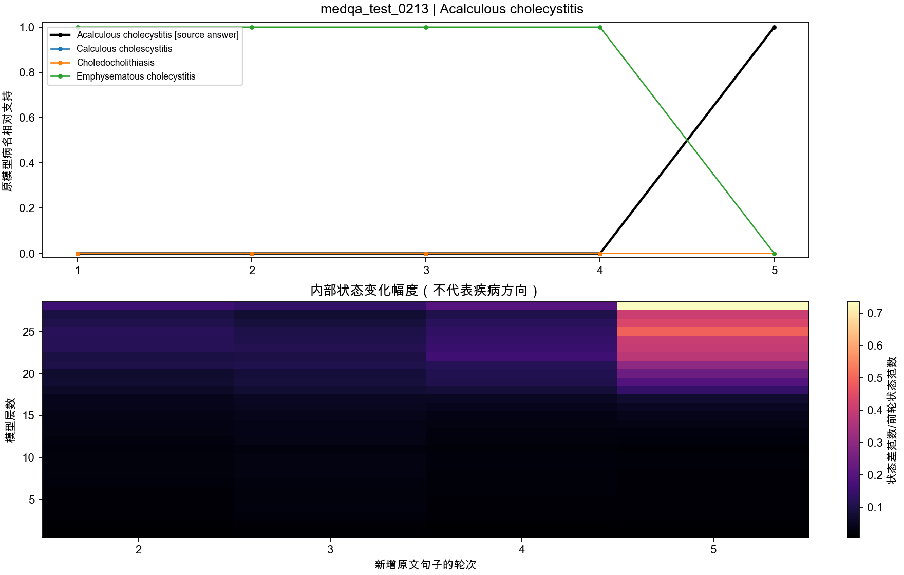

# medqa_test_0213：Acalculous cholecystitis

来源：MedQA四选项test，第213行（零起始）。来源答案只用于完整题目评价。路径：转向来源病后保持。下图没有用DDxPlus探针解码MedQA病名。

Which of the following is the most likely diagnosis?

| 轮 | 原模型首选 | 来源答案支持 | 本轮新增原文 |
|---|---|---:|---|
| 1 | Emphysematous cholecystitis | 0.0000 | A 67-year-old woman presents from home hospice with a change in her mental status. |
| 2 | Emphysematous cholecystitis | 0.0000 | She has seemed more confused lately and is unable to verbalize her symptoms. |
| 3 | Emphysematous cholecystitis | 0.0000 | Her temperature is 102°F (38.9°C), blood pressure is 117/65 mmHg, pulse is 110/min, respirations are 19/min, and oxygen saturation is 95% on room air. |
| 4 | Emphysematous cholecystitis | 0.0000 | Physical exam is notable for a right upper quadrant mass that elicits discomfort when palpated. |
| 5 | Acalculous cholecystitis | 1.0000 | Ultrasound is notable for pericholecystic fluid and gallbladder wall thickening without any gallstones. |

| 完整题目控制 | 原模型首选 | 来源答案支持改变 |
|---|---|---:|
| reverse | Acalculous cholecystitis | +0.0000 |
| shuffle | Acalculous cholecystitis | +0.0000 |
| wrong_history | Emphysematous cholecystitis | -1.0000 |

原题选项：{"A": "Acalculous cholecystitis", "B": "Calculous cholescystitis", "C": "Choledocholithiasis", "D": "Emphysematous cholecystitis"}
