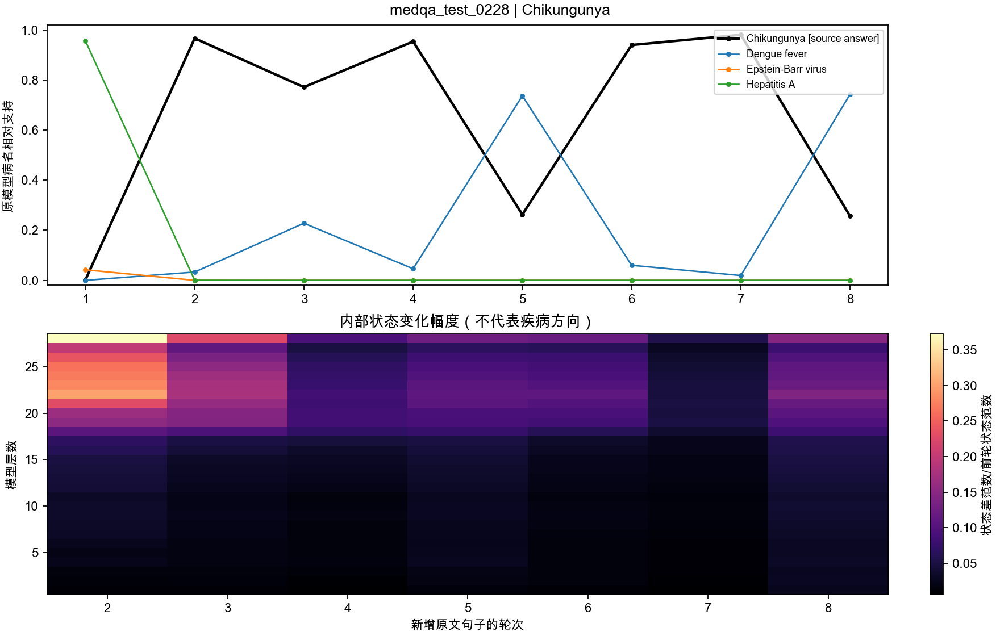

# medqa_test_0228：Chikungunya

来源：MedQA四选项test，第228行（零起始）。来源答案只用于完整题目评价。路径：曾选来源病，最后离开。下图没有用DDxPlus探针解码MedQA病名。

Which of the following is the most likely diagnosis in this patient?

| 轮 | 原模型首选 | 来源答案支持 | 本轮新增原文 |
|---|---|---:|---|
| 1 | Hepatitis A | 0.0016 | A 21-year-old male presents to his primary care provider for fatigue. |
| 2 | Chikungunya | 0.9667 | He reports that he graduated from college last month and returned 3 days ago from a 2 week vacation to Vietnam and Cambodia. |
| 3 | Chikungunya | 0.7718 | For the past 2 days, he has developed a worsening headache, malaise, and pain in his hands and wrists. |
| 4 | Chikungunya | 0.9540 | The patient has a past medical history of asthma managed with albuterol as needed. |
| 5 | Dengue fever | 0.2628 | He is sexually active with both men and women, and he uses condoms “most of the time.” On physical exam, the patient’s temperature is 102.5°F (39.2°C), blood pressure is 112/66 mmHg, pulse is 105/min, respirations are 12/min, and oxygen saturation is 98% on room air. |
| 6 | Chikungunya | 0.9399 | He has tenderness to palpation over his bilateral metacarpophalangeal joints and a maculopapular rash on his trunk and upper thighs. |
| 7 | Chikungunya | 0.9809 | Tourniquet test is negative. |
| 8 | Dengue fever | 0.2568 | Laboratory results are as follows:

Hemoglobin: 14 g/dL
Hematocrit: 44%
Leukocyte count: 3,200/mm^3
Platelet count: 112,000/mm^3

Serum:
Na+: 142 mEq/L
Cl-: 104 mEq/L
K+: 4.6 mEq/L
HCO3-: 24 mEq/L
BUN: 18 mg/dL
Glucose: 87 mg/dL
Creatinine: 0.9 mg/dL
AST: 106 U/L
ALT: 112 U/L
Bilirubin (total): 0.8 mg/dL
Bilirubin (conjugated): 0.3 mg/dL |

| 完整题目控制 | 原模型首选 | 来源答案支持改变 |
|---|---|---:|
| reverse | Chikungunya | +0.7405 |
| shuffle | Dengue fever | -0.2458 |
| wrong_history | Dengue fever | -0.2568 |

原题选项：{"A": "Chikungunya", "B": "Dengue fever", "C": "Epstein-Barr virus", "D": "Hepatitis A"}
