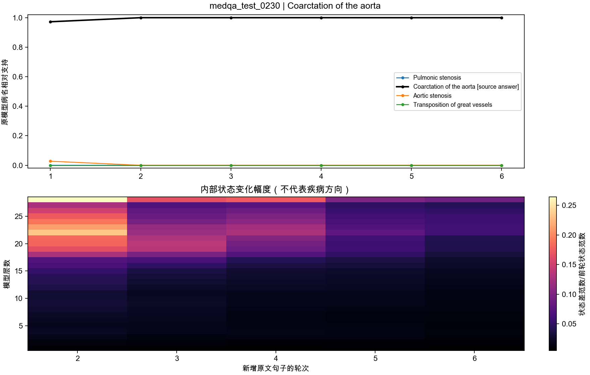

# medqa_test_0230：Coarctation of the aorta

来源：MedQA四选项test，第230行（零起始）。来源答案只用于完整题目评价。路径：始终首选来源病。下图没有用DDxPlus探针解码MedQA病名。

What is the most likely diagnosis in this patient?

| 轮 | 原模型首选 | 来源答案支持 | 本轮新增原文 |
|---|---|---:|---|
| 1 | Coarctation of the aorta | 0.9724 | An 11-year-old child complains of pain in the leg while playing. |
| 2 | Coarctation of the aorta | 1.0000 | Blood pressure in the upper limb is 140/90 mm Hg and lower limbs are 110/70 mm Hg. |
| 3 | Coarctation of the aorta | 1.0000 | There is a brachiofemoral delay in the pulse. |
| 4 | Coarctation of the aorta | 1.0000 | Auscultation shows a loud S1, loud S2, and S4. |
| 5 | Coarctation of the aorta | 0.9998 | There is a presence of an ejection systolic murmur in the interscapular area. |
| 6 | Coarctation of the aorta | 1.0000 | Chest X-ray reveals the notching of the ribs. |

| 完整题目控制 | 原模型首选 | 来源答案支持改变 |
|---|---|---:|
| reverse | Coarctation of the aorta | +0.0000 |
| shuffle | Coarctation of the aorta | +0.0000 |
| wrong_history | Coarctation of the aorta | -0.0000 |

原题选项：{"A": "Pulmonic stenosis", "B": "Coarctation of the aorta", "C": "Aortic stenosis", "D": "Transposition of great vessels"}
