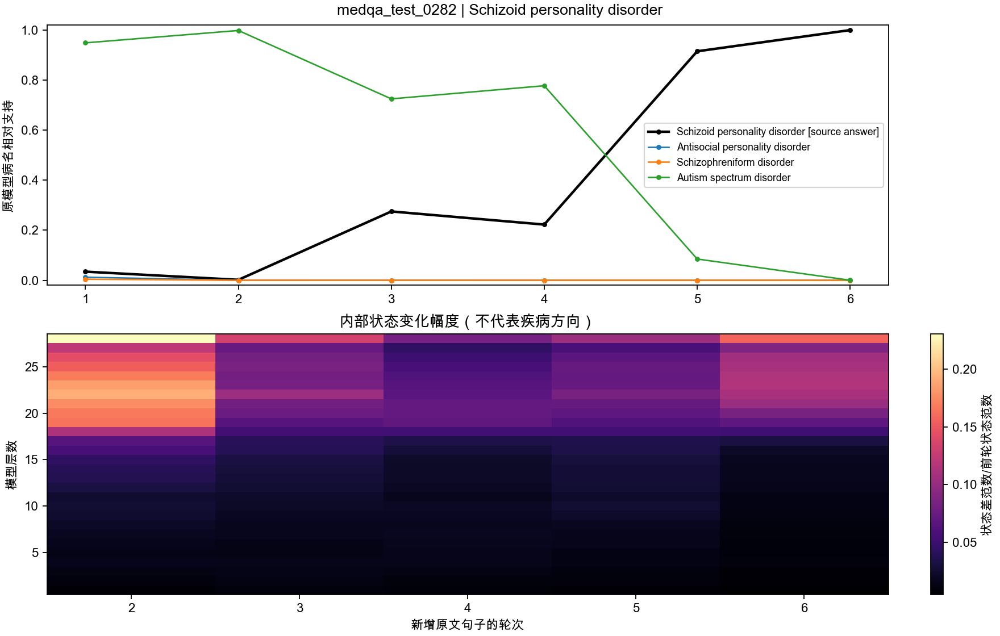

# medqa_test_0282：Schizoid personality disorder

来源：MedQA四选项test，第282行（零起始）。来源答案只用于完整题目评价。路径：转向来源病后保持。下图没有用DDxPlus探针解码MedQA病名。

Which of the following is the most likely diagnosis?

| 轮 | 原模型首选 | 来源答案支持 | 本轮新增原文 |
|---|---|---:|---|
| 1 | Autism spectrum disorder | 0.0346 | A 16-year-old girl is brought to the physician by her father because of concerns about her behavior during the past 2 years. |
| 2 | Autism spectrum disorder | 0.0020 | She does not have friends and spends most of the time reading by herself. |
| 3 | Autism spectrum disorder | 0.2751 | Her father says that she comes up with excuses to avoid family dinners and other social events. |
| 4 | Autism spectrum disorder | 0.2227 | She states that she likes reading and feels more comfortable on her own. |
| 5 | Schizoid personality disorder | 0.9149 | On mental status examination, her thought process is organized and logical. |
| 6 | Schizoid personality disorder | 0.9996 | Her affect is flat. |

| 完整题目控制 | 原模型首选 | 来源答案支持改变 |
|---|---|---:|
| reverse | Schizoid personality disorder | -0.1034 |
| shuffle | Schizoid personality disorder | -0.0146 |
| wrong_history | Schizoid personality disorder | +0.0003 |

原题选项：{"A": "Schizoid personality disorder", "B": "Antisocial personality disorder", "C": "Schizophreniform disorder", "D": "Autism spectrum disorder"}
