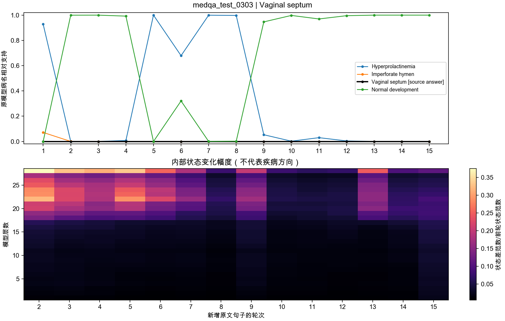

# medqa_test_0303：Vaginal septum

来源：MedQA四选项test，第303行（零起始）。来源答案只用于完整题目评价。路径：在其他疾病间变动。下图没有用DDxPlus探针解码MedQA病名。

Which of the following is the most likely diagnosis?

| 轮 | 原模型首选 | 来源答案支持 | 本轮新增原文 |
|---|---|---:|---|
| 1 | Hyperprolactinemia | 0.0000 | A 16-year-old female presents to her primary care physician due to lack of menstruation. |
| 2 | Normal development | 0.0000 | She has never had a period and is anxious that she is not “keeping up” with her friends. |
| 3 | Normal development | 0.0000 | She states that her breasts began developing when she was 13, and she had a growth spurt around the same time. |
| 4 | Normal development | 0.0000 | Review of systems reveals that she has also been getting headaches every few months over the last year with some photosensitivity and nausea each time. |
| 5 | Hyperprolactinemia | 0.0000 | Ibuprofen relieves her symptoms. |
| 6 | Hyperprolactinemia | 0.0000 | The patient is a competitive ice skater and has never been sexually active. |
| 7 | Hyperprolactinemia | 0.0000 | Her mother has a history of migraine headaches, and her older sister has a history of bipolar disorder. |
| 8 | Hyperprolactinemia | 0.0000 | Both underwent menarche at age 15. |
| 9 | Normal development | 0.0000 | At this visit, the patient’s temperature is 98.6°F (37.0°C), pulse is 70/min, blood pressure is 118/65 mmHg, and respirations are 13/min. |
| 10 | Normal development | 0.0000 | Her body mass index is 23.8 kg/m^2. |
| 11 | Normal development | 0.0000 | Cardiopulmonary and abdominal exams are unremarkable. |
| 12 | Normal development | 0.0000 | Both breasts are Tanner IV with no expressable discharge. |
| 13 | Normal development | 0.0000 | Pelvic and axillary hair growth is also Tanner IV. |
| 14 | Normal development | 0.0000 | The patient is unable to tolerate a full pelvic exam, but the part of the vaginal canal that is examined is unremarkable. |
| 15 | Normal development | 0.0000 | Laboratory studies are ordered and are below:

Serum:
Na+: 139 mEq/L
K+: 4.1 mEq/L
Cl-: 100 mEq/L
HCO3-: 24 mEq/L
Urea nitrogen: 12 mg/dL
Glucose: 73 mg/dL
Creatinine: 0.9 mg/dL
Ca2+: 9.7 mg/dL
Mg2+: 1.7 mEq/L
AST: 11 U/L
ALT: 11 U/L
Follicle Stimulating Hormone (FSH): 16.2 mIU/mL (4.7-21.5 mIU/ml)
Estrogen: 240 pg/mL (64-357 pg/mL)

Abdominal ultrasound is performed and shows a normal uterus and ovaries. |

| 完整题目控制 | 原模型首选 | 来源答案支持改变 |
|---|---|---:|
| reverse | Hyperprolactinemia | +0.0000 |
| shuffle | Normal development | +0.0000 |
| wrong_history | Hyperprolactinemia | +0.0000 |

原题选项：{"A": "Hyperprolactinemia", "B": "Imperforate hymen", "C": "Vaginal septum", "D": "Normal development"}
