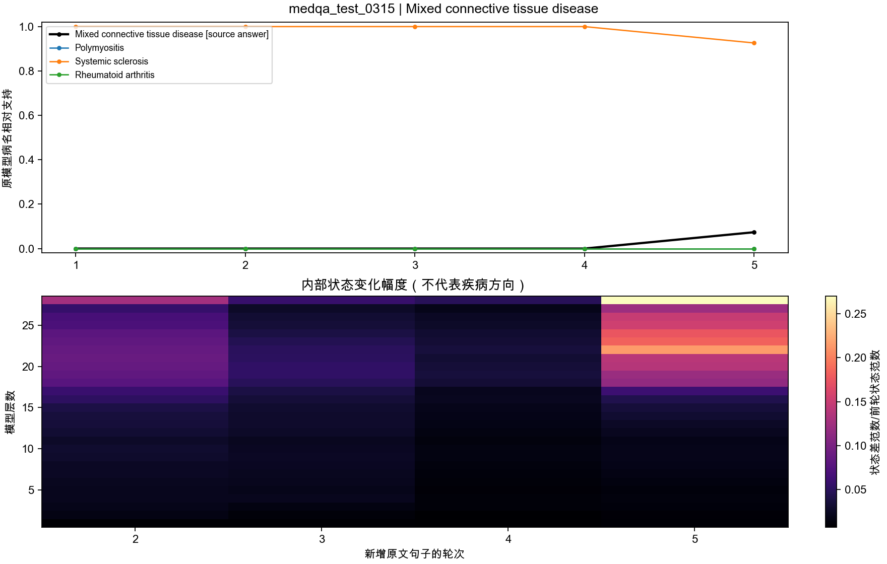

# medqa_test_0315：Mixed connective tissue disease

来源：MedQA四选项test，第315行（零起始）。来源答案只用于完整题目评价。路径：始终固定另一病。下图没有用DDxPlus探针解码MedQA病名。

What is the most likely diagnosis in this patient?

| 轮 | 原模型首选 | 来源答案支持 | 本轮新增原文 |
|---|---|---:|---|
| 1 | Systemic sclerosis | 0.0000 | A 27-year-old woman was referred to a dermatology clinic due to a changing discoloration of her fingers from white to red to blue. |
| 2 | Systemic sclerosis | 0.0000 | Although she has not had any recent changes in her daily routines, she also complains of increasing fatigue, muscle weakness, and weight loss. |
| 3 | Systemic sclerosis | 0.0000 | She has a blood pressure of 126/77 mm Hg, respiratory rate of 14/min, and heart rate of 88/min. |
| 4 | Systemic sclerosis | 0.0000 | Physical examination reveals regular heart and lung sounds. |
| 5 | Systemic sclerosis | 0.0737 | Anti-U1 RNP antibodies and increased creatinine kinase were found in her serum. |

| 完整题目控制 | 原模型首选 | 来源答案支持改变 |
|---|---|---:|
| reverse | Systemic sclerosis | -0.0717 |
| shuffle | Systemic sclerosis | -0.0717 |
| wrong_history | Systemic sclerosis | -0.0736 |

原题选项：{"A": "Mixed connective tissue disease", "B": "Polymyositis", "C": "Systemic sclerosis", "D": "Rheumatoid arthritis"}
