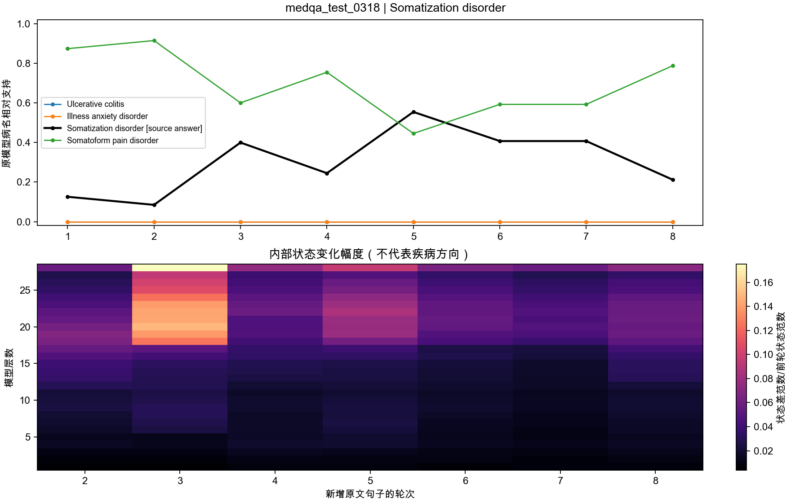

# medqa_test_0318：Somatization disorder

来源：MedQA四选项test，第318行（零起始）。来源答案只用于完整题目评价。路径：曾选来源病，最后离开。下图没有用DDxPlus探针解码MedQA病名。

Which of the following is the most likely diagnosis?

| 轮 | 原模型首选 | 来源答案支持 | 本轮新增原文 |
|---|---|---:|---|
| 1 | Somatoform pain disorder | 0.1259 | A 21-year-old woman presents to the emergency room with right arm pain and limited range of motion. |
| 2 | Somatoform pain disorder | 0.0851 | She does not recall trauma to the arm. |
| 3 | Somatoform pain disorder | 0.3998 | She also complains of diarrhea and nausea. |
| 4 | Somatoform pain disorder | 0.2450 | She is sexually active with one male partner and admits to having pain during intercourse. |
| 5 | Somatization disorder | 0.5544 | There is vague and diffuse tenderness to palpation in all four abdominal quadrants. |
| 6 | Somatoform pain disorder | 0.4072 | No erythema or edema is noted on the right arm. |
| 7 | Somatoform pain disorder | 0.4073 | The fecal occult test is negative. |
| 8 | Somatoform pain disorder | 0.2120 | Past records show that this patient has been in the ER 7 times in the past year with similar symptoms. |

| 完整题目控制 | 原模型首选 | 来源答案支持改变 |
|---|---|---:|
| reverse | Somatoform pain disorder | -0.1194 |
| shuffle | Somatoform pain disorder | -0.0827 |
| wrong_history | Somatization disorder | +0.7578 |

原题选项：{"A": "Ulcerative colitis", "B": "Illness anxiety disorder", "C": "Somatization disorder", "D": "Somatoform pain disorder"}
