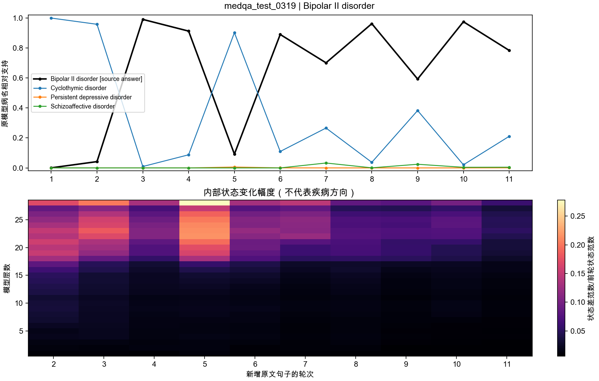

# medqa_test_0319：Bipolar II disorder

来源：MedQA四选项test，第319行（零起始）。来源答案只用于完整题目评价。路径：曾离开来源病，最后回来。下图没有用DDxPlus探针解码MedQA病名。

Which of the following is the most likely diagnosis in this patient?

| 轮 | 原模型首选 | 来源答案支持 | 本轮新增原文 |
|---|---|---:|---|
| 1 | Cyclothymic disorder | 0.0006 | A 22-year-old man presents to a psychiatrist complaining of mood fluctuations. |
| 2 | Cyclothymic disorder | 0.0421 | He is accompanied by his mother who reports that the patient recently experienced a 5-day episode of minimal sleep and unusual levels of energy. |
| 3 | Bipolar II disorder | 0.9905 | The patient admits to spending $2,000 of his parent’s money, without asking, on a down payment for a motorcycle. |
| 4 | Bipolar II disorder | 0.9124 | The episode resolved after 5 days, at which point the patient felt guilty and upset. |
| 5 | Cyclothymic disorder | 0.0921 | The patient’s medical history is notable for multiple month-long episodes in the past 2 years of feeling sad, sleeping more than usual, being uninterested in his hobbies, and feeling constantly tired and guilty. |
| 6 | Bipolar II disorder | 0.8899 | The patient has a history of severe meningoencephalitis at the age of 17 requiring four days in the intensive care unit. |
| 7 | Bipolar II disorder | 0.7010 | During that episode, he reported seeing monkeys in his hospital room. |
| 8 | Bipolar II disorder | 0.9620 | On exam, he is a well-appearing, cooperative male in no acute distress. |
| 9 | Bipolar II disorder | 0.5928 | He is alert and oriented with a normal affect. |
| 10 | Bipolar II disorder | 0.9749 | He states that he feels sad and guilty about what happens. |
| 11 | Bipolar II disorder | 0.7835 | He denies suicidal ideation. |

| 完整题目控制 | 原模型首选 | 来源答案支持改变 |
|---|---|---:|
| reverse | Schizoaffective disorder | -0.7835 |
| shuffle | Cyclothymic disorder | -0.7291 |
| wrong_history | Cyclothymic disorder | -0.7835 |

原题选项：{"A": "Bipolar II disorder", "B": "Cyclothymic disorder", "C": "Persistent depressive disorder", "D": "Schizoaffective disorder"}
