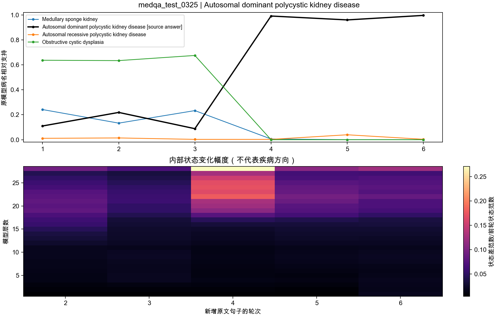

# medqa_test_0325：Autosomal dominant polycystic kidney disease

来源：MedQA四选项test，第325行（零起始）。来源答案只用于完整题目评价。路径：转向来源病后保持。下图没有用DDxPlus探针解码MedQA病名。

Which of the following is the most likely diagnosis?

| 轮 | 原模型首选 | 来源答案支持 | 本轮新增原文 |
|---|---|---:|---|
| 1 | Obstructive cystic dysplasia | 0.1101 | A 31-year-old woman comes to the physician because of a 5-month history of intermittent flank pain. |
| 2 | Obstructive cystic dysplasia | 0.2188 | Over the past 2 years, she has had five urinary tract infections. |
| 3 | Obstructive cystic dysplasia | 0.0885 | Her blood pressure is 150/88 mm Hg. |
| 4 | Autosomal dominant polycystic kidney disease | 0.9914 | Physical examination shows bilateral, nontender upper abdominal masses. |
| 5 | Autosomal dominant polycystic kidney disease | 0.9602 | Serum studies show a urea nitrogen concentration of 29 mg/dL and a creatinine concentration of 1.4 mg/dL. |
| 6 | Autosomal dominant polycystic kidney disease | 0.9964 | Renal ultrasonography shows bilaterally enlarged kidneys with multiple parenchymal anechoic masses. |

| 完整题目控制 | 原模型首选 | 来源答案支持改变 |
|---|---|---:|
| reverse | Autosomal dominant polycystic kidney disease | -0.2409 |
| shuffle | Autosomal dominant polycystic kidney disease | -0.0016 |
| wrong_history | Autosomal dominant polycystic kidney disease | -0.0358 |

原题选项：{"A": "Medullary sponge kidney", "B": "Autosomal dominant polycystic kidney disease", "C": "Autosomal recessive polycystic kidney disease", "D": "Obstructive cystic dysplasia"}
