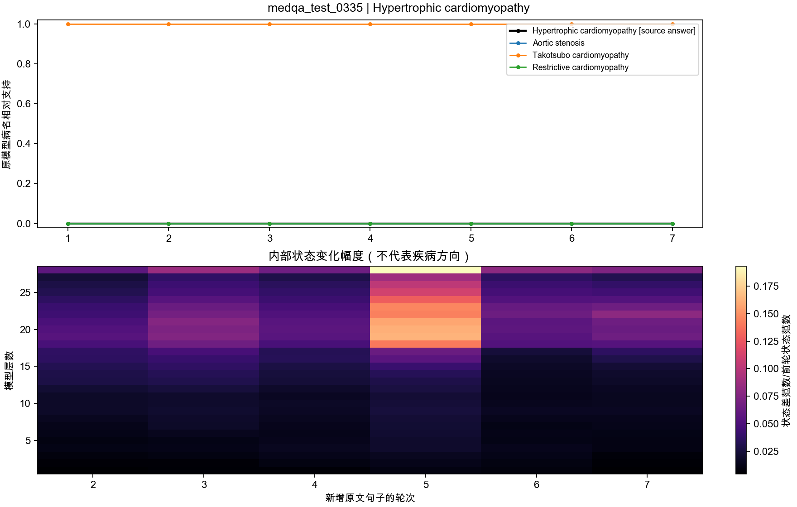

# medqa_test_0335：Hypertrophic cardiomyopathy

来源：MedQA四选项test，第335行（零起始）。来源答案只用于完整题目评价。路径：始终固定另一病。下图没有用DDxPlus探针解码MedQA病名。

What is the most likely diagnosis?

| 轮 | 原模型首选 | 来源答案支持 | 本轮新增原文 |
|---|---|---:|---|
| 1 | Takotsubo cardiomyopathy | 0.0000 | A 23-year-old man presents with sudden loss of consciousness while pitching in a baseball game. |
| 2 | Takotsubo cardiomyopathy | 0.0000 | There is no history of injury. |
| 3 | Takotsubo cardiomyopathy | 0.0000 | Consciousness is regained after cardiopulmonary resuscitation. |
| 4 | Takotsubo cardiomyopathy | 0.0000 | Past medical history is negative for any neurological and cardiovascular problems. |
| 5 | Takotsubo cardiomyopathy | 0.0000 | Physical examination reveals a prominent A wave on the jugular venous pulse and a double apical impulse. |
| 6 | Takotsubo cardiomyopathy | 0.0000 | There are no audible murmurs. |
| 7 | Takotsubo cardiomyopathy | 0.0000 | An S4 is present. |

| 完整题目控制 | 原模型首选 | 来源答案支持改变 |
|---|---|---:|
| reverse | Takotsubo cardiomyopathy | +0.0000 |
| shuffle | Takotsubo cardiomyopathy | +0.0000 |
| wrong_history | Aortic stenosis | +0.0000 |

原题选项：{"A": "Hypertrophic cardiomyopathy", "B": "Aortic stenosis", "C": "Takotsubo cardiomyopathy", "D": "Restrictive cardiomyopathy"}
