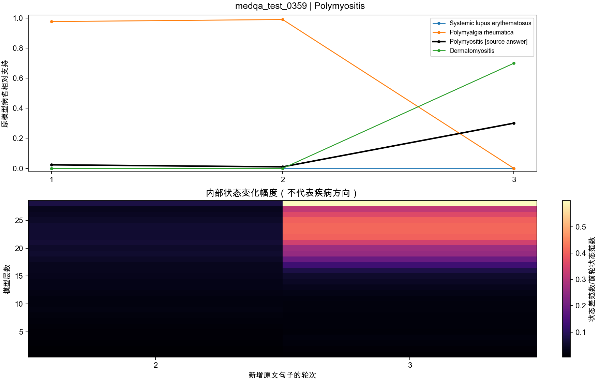

# medqa_test_0359：Polymyositis

来源：MedQA四选项test，第359行（零起始）。来源答案只用于完整题目评价。路径：在其他疾病间变动。下图没有用DDxPlus探针解码MedQA病名。

Which of the following is the most likely diagnosis?

| 轮 | 原模型首选 | 来源答案支持 | 本轮新增原文 |
|---|---|---:|---|
| 1 | Polymyalgia rheumatica | 0.0237 | A 40-year-old male presents to your office complaining that he is too weak to climb stairs or brush his hair. |
| 2 | Polymyalgia rheumatica | 0.0100 | He denies any headaches or change in vision. |
| 3 | Dermatomyositis | 0.3006 | A muscle biopsy reveals CD8+ lymphocyte infiltration in the endomysium. |

| 完整题目控制 | 原模型首选 | 来源答案支持改变 |
|---|---|---:|
| reverse | Polymyositis | +0.2919 |
| shuffle | Dermatomyositis | -0.2694 |
| wrong_history | Polymyositis | +0.6041 |

原题选项：{"A": "Systemic lupus erythematosus", "B": "Polymyalgia rheumatica", "C": "Polymyositis", "D": "Dermatomyositis"}
