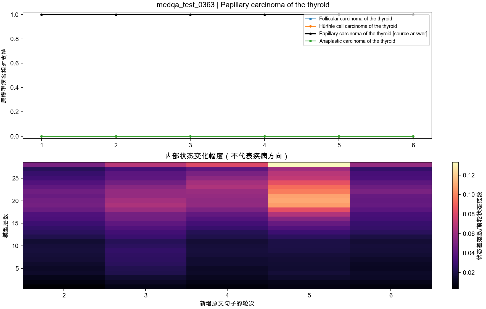

# medqa_test_0363：Papillary carcinoma of the thyroid

来源：MedQA四选项test，第363行（零起始）。来源答案只用于完整题目评价。路径：始终首选来源病。下图没有用DDxPlus探针解码MedQA病名。

Which of the following is the most likely diagnosis?

| 轮 | 原模型首选 | 来源答案支持 | 本轮新增原文 |
|---|---|---:|---|
| 1 | Papillary carcinoma of the thyroid | 1.0000 | A 36-year-old woman comes to the physician because of a painless lump on her neck for 3 months that has increased in size. |
| 2 | Papillary carcinoma of the thyroid | 1.0000 | She appears healthy. |
| 3 | Papillary carcinoma of the thyroid | 1.0000 | Examination shows a 2.5-cm (1-in) firm, irregular swelling on the left side of the neck that moves with swallowing. |
| 4 | Papillary carcinoma of the thyroid | 1.0000 | There is painless cervical lymphadenopathy. |
| 5 | Papillary carcinoma of the thyroid | 1.0000 | Ultrasound of the neck shows a solitary left lobe thyroid mass with increased vascularity and hyperechogenic punctate regions. |
| 6 | Papillary carcinoma of the thyroid | 1.0000 | A fine needle aspiration biopsy is scheduled for the following week. |

| 完整题目控制 | 原模型首选 | 来源答案支持改变 |
|---|---|---:|
| reverse | Papillary carcinoma of the thyroid | -0.0000 |
| shuffle | Papillary carcinoma of the thyroid | +0.0000 |
| wrong_history | Papillary carcinoma of the thyroid | -0.0005 |

原题选项：{"A": "Follicular carcinoma of the thyroid", "B": "Hürthle cell carcinoma of the thyroid", "C": "Papillary carcinoma of the thyroid", "D": "Anaplastic carcinoma of the thyroid"}
