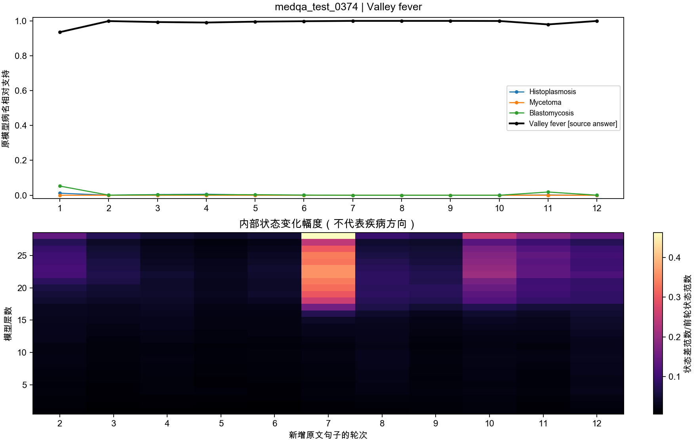

# medqa_test_0374：Valley fever

来源：MedQA四选项test，第374行（零起始）。来源答案只用于完整题目评价。路径：始终首选来源病。下图没有用DDxPlus探针解码MedQA病名。

Which of the following is the most likely diagnosis?

| 轮 | 原模型首选 | 来源答案支持 | 本轮新增原文 |
|---|---|---:|---|
| 1 | Valley fever | 0.9354 | A 50-year-old man presents to his physician with chronic cough, aching joints in his hips and lower back, and malaise over the past 2 months. |
| 2 | Valley fever | 0.9989 | He describes himself as being “generally healthy” before the cough began. |
| 3 | Valley fever | 0.9934 | Past medical history includes hypertension. |
| 4 | Valley fever | 0.9906 | The patient takes clopamide and a multivitamin daily. |
| 5 | Valley fever | 0.9956 | His parents are both well and living in a senior living facility. |
| 6 | Valley fever | 0.9981 | He does not smoke and only drinks alcohol occasionally. |
| 7 | Valley fever | 1.0000 | During a review of symptoms, the patient described a hiking trip in and around the desert near Phoenix, Arizona, 4 months ago. |
| 8 | Valley fever | 1.0000 | At the office, his temperature is 38.6°C (101.4°F), heart rate is 102/min, respirations are 20/min, and blood pressure is 120/82 mm Hg. |
| 9 | Valley fever | 1.0000 | A focused chest exam reveals mild fremetus and dullness with percussion on the right side. |
| 10 | Valley fever | 0.9994 | A chest X-ray shows a right-sided consolidation of the lower right lung, and a chest CT shows an irregular opacity measuring 3.8 cm x 3.0 cm in the sub-plural region of the right middle lobe, a small right-sided pleural effusion, and mild right-sided hilar adenopathy. |
| 11 | Valley fever | 0.9798 | A lung biopsy is performed to rule out cancer and reveals necrotic granulomatous inflammation with multinucleated giant cells and spherules with endospores in the surrounding tissues. |
| 12 | Valley fever | 0.9995 | The laboratory tests show the following results:
Hemoglobin 12.9 mg/dL
Leukocyte count 9,300/mm3
Platelet count 167,000/mm3
Erythrocyte sedimentation rate 43 mm/hr
Periodic acid-Schiff and silver methenamine Positive
Acid-fast stain Negative |

| 完整题目控制 | 原模型首选 | 来源答案支持改变 |
|---|---|---:|
| reverse | Valley fever | +0.0005 |
| shuffle | Valley fever | +0.0005 |
| wrong_history | Mycetoma | -0.9995 |

原题选项：{"A": "Histoplasmosis", "B": "Mycetoma", "C": "Blastomycosis", "D": "Valley fever"}
