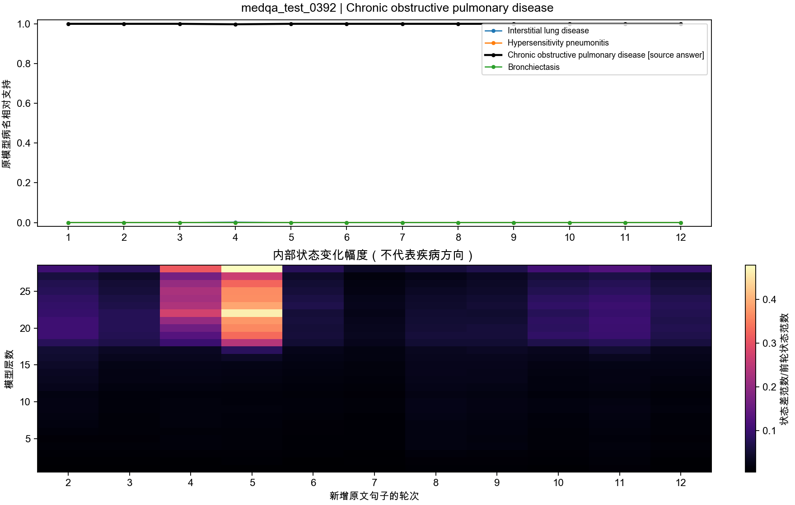

# medqa_test_0392：Chronic obstructive pulmonary disease

来源：MedQA四选项test，第392行（零起始）。来源答案只用于完整题目评价。路径：始终首选来源病。下图没有用DDxPlus探针解码MedQA病名。

Which of the following is the most likely diagnosis?

| 轮 | 原模型首选 | 来源答案支持 | 本轮新增原文 |
|---|---|---:|---|
| 1 | Chronic obstructive pulmonary disease | 1.0000 | A previously healthy 60-year-old man comes to his physician because of progressively worsening shortness of breath for the past 2 months. |
| 2 | Chronic obstructive pulmonary disease | 1.0000 | He does not experience shortness of breath at rest. |
| 3 | Chronic obstructive pulmonary disease | 1.0000 | He also occasionally has a dry cough. |
| 4 | Chronic obstructive pulmonary disease | 0.9977 | He has not had fever, chills, or night sweats. |
| 5 | Chronic obstructive pulmonary disease | 1.0000 | He has smoked a pack of cigarettes daily for the past 40 years. |
| 6 | Chronic obstructive pulmonary disease | 1.0000 | He drinks a beer daily and occasionally more on weekends. |
| 7 | Chronic obstructive pulmonary disease | 1.0000 | He does not use illicit drugs. |
| 8 | Chronic obstructive pulmonary disease | 1.0000 | He is 183 cm (6 ft 0 in) tall and weighs 66 kg (145 lbs); BMI is 19.7 kg/m2. |
| 9 | Chronic obstructive pulmonary disease | 1.0000 | His temperature is 37°C (98.6°F), pulse is 94/min, respirations are 21/min, and blood pressure is 136/88 mm Hg. |
| 10 | Chronic obstructive pulmonary disease | 1.0000 | Lung auscultation reveals a prolonged expiratory phase and end-expiratory wheezing. |
| 11 | Chronic obstructive pulmonary disease | 1.0000 | Spirometry shows an FEV1:FVC ratio of 62%, an FEV1 of 60% of predicted, and a total lung capacity of 125% of predicted. |
| 12 | Chronic obstructive pulmonary disease | 1.0000 | The diffusion capacity of the lung (DLCO) is decreased. |

| 完整题目控制 | 原模型首选 | 来源答案支持改变 |
|---|---|---:|
| reverse | Chronic obstructive pulmonary disease | -0.0000 |
| shuffle | Chronic obstructive pulmonary disease | +0.0000 |
| wrong_history | Chronic obstructive pulmonary disease | -0.0000 |

原题选项：{"A": "Interstitial lung disease", "B": "Hypersensitivity pneumonitis", "C": "Chronic obstructive pulmonary disease", "D": "Bronchiectasis"}
