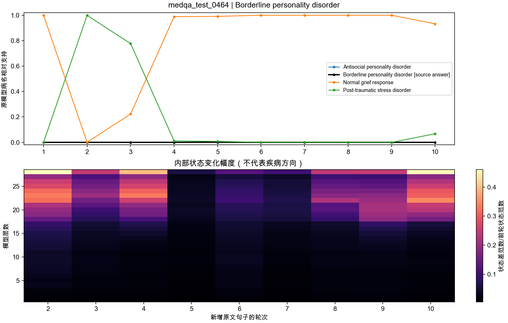

# medqa_test_0464：Borderline personality disorder

来源：MedQA四选项test，第464行（零起始）。来源答案只用于完整题目评价。路径：在其他疾病间变动。下图没有用DDxPlus探针解码MedQA病名。

Which of the following is the most likely diagnosis?

| 轮 | 原模型首选 | 来源答案支持 | 本轮新增原文 |
|---|---|---:|---|
| 1 | Normal grief response | 0.0000 | A 22-year-old woman presents to the emergency department for abdominal pain. |
| 2 | Post-traumatic stress disorder | 0.0001 | The patient has been trying to get pregnant and was successful recently, but now she is experiencing abdominal pain, contractions, and a bloody vaginal discharge. |
| 3 | Post-traumatic stress disorder | 0.0000 | According to her last appointment with her primary care provider, she is 10 weeks pregnant. |
| 4 | Normal grief response | 0.0001 | The patient has a past medical history of constipation, anxiety, and substance abuse. |
| 5 | Normal grief response | 0.0013 | She is not currently taking any medications. |
| 6 | Normal grief response | 0.0000 | Her temperature is 99.5°F (37.5°C), blood pressure is 107/58 mmHg, pulse is 90/min, respirations are 17/min, and oxygen saturation is 98% on room air. |
| 7 | Normal grief response | 0.0000 | Physical exam is notable for a bloody vaginal discharge and an open cervix. |
| 8 | Normal grief response | 0.0000 | The patient is initially extremely grateful for the care she is receiving and thanks the doctor and the nursing staff for saving her baby. |
| 9 | Normal grief response | 0.0000 | Upon hearing the news that she is having a spontaneous abortion, the patient becomes angry and aggressive and states that her physician and the medical staff are incompetent, evil, and she is going to sue all of them. |
| 10 | Normal grief response | 0.0000 | The patient is left to grieve but upon entering the room again you notice that the patient has new lacerations over her wrists and that some of the medical equipment in the room is broken. |

| 完整题目控制 | 原模型首选 | 来源答案支持改变 |
|---|---|---:|
| reverse | Normal grief response | -0.0000 |
| shuffle | Normal grief response | -0.0000 |
| wrong_history | Post-traumatic stress disorder | -0.0000 |

原题选项：{"A": "Antisocial personality disorder", "B": "Borderline personality disorder", "C": "Normal grief response", "D": "Post-traumatic stress disorder"}
