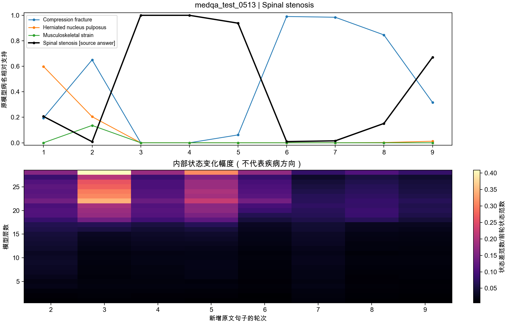

# medqa_test_0513：Spinal stenosis

来源：MedQA四选项test，第513行（零起始）。来源答案只用于完整题目评价。路径：曾离开来源病，最后回来。下图没有用DDxPlus探针解码MedQA病名。

Which of the following is the most likely diagnosis?

| 轮 | 原模型首选 | 来源答案支持 | 本轮新增原文 |
|---|---|---:|---|
| 1 | Herniated nucleus pulposus | 0.2069 | A 65-year-old man presents to the emergency department with back pain. |
| 2 | Compression fracture | 0.0084 | The patient states that he has gradually worsening back pain that seems to have worsened after moving furniture the other day. |
| 3 | Spinal stenosis | 0.9998 | He also states that while he walks, he feels numbness and weakness in his legs. |
| 4 | Spinal stenosis | 0.9999 | The only time the patient states his back pain is improved is when he is riding his bike or pushing a cart at the grocery store. |
| 5 | Spinal stenosis | 0.9381 | The patient has a past medical history of osteoporosis, dyslipidemia, and diabetes. |
| 6 | Compression fracture | 0.0094 | He drinks 3 alcoholic drinks every day and has a 44 pack-year smoking history. |
| 7 | Compression fracture | 0.0154 | His temperature is 99.5°F (37.5°C), blood pressure is 157/108 mmHg, pulse is 90/min, respirations are 17/min, and oxygen saturation is 98% on room air. |
| 8 | Compression fracture | 0.1517 | Physical exam is notable for a non-tender spine with normal mobility in all 4 directions. |
| 9 | Spinal stenosis | 0.6708 | Radiography of the spine and basic labs are ordered. |

| 完整题目控制 | 原模型首选 | 来源答案支持改变 |
|---|---|---:|
| reverse | Spinal stenosis | +0.3281 |
| shuffle | Spinal stenosis | +0.3077 |
| wrong_history | Spinal stenosis | -0.0886 |

原题选项：{"A": "Compression fracture", "B": "Herniated nucleus pulposus", "C": "Musculoskeletal strain", "D": "Spinal stenosis"}
