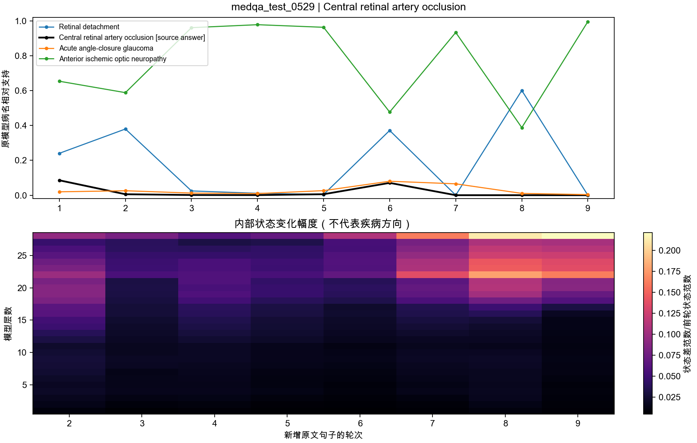

# medqa_test_0529：Central retinal artery occlusion

来源：MedQA四选项test，第529行（零起始）。来源答案只用于完整题目评价。路径：在其他疾病间变动。下图没有用DDxPlus探针解码MedQA病名。

Which of the following is the most likely diagnosis?

| 轮 | 原模型首选 | 来源答案支持 | 本轮新增原文 |
|---|---|---:|---|
| 1 | Anterior ischemic optic neuropathy | 0.0858 | A 60-year-old woman is brought to the emergency department because of sudden, painless loss of vision in her right eye that occurred 30 minutes ago while watching TV. |
| 2 | Anterior ischemic optic neuropathy | 0.0058 | She has coronary artery disease, hypertension, and type 2 diabetes mellitus; she has had trouble adhering to her medication regimen. |
| 3 | Anterior ischemic optic neuropathy | 0.0015 | Her blood pressure is 160/85 mm Hg. |
| 4 | Anterior ischemic optic neuropathy | 0.0010 | Examination shows 20/50 vision in the left eye and no perception of light in the right eye. |
| 5 | Anterior ischemic optic neuropathy | 0.0059 | Direct pupillary reflex is present in the left eye, but absent in the right eye. |
| 6 | Anterior ischemic optic neuropathy | 0.0709 | Accommodation is intact bilaterally. |
| 7 | Anterior ischemic optic neuropathy | 0.0003 | Intraocular pressure is 16 mm Hg in the left eye and 18 mm Hg in the right eye. |
| 8 | Retinal detachment | 0.0004 | Fundoscopic examination of the right eye shows a pale, white retina with a bright red area within the macula. |
| 9 | Anterior ischemic optic neuropathy | 0.0003 | The optic disc appears normal. |

| 完整题目控制 | 原模型首选 | 来源答案支持改变 |
|---|---|---:|
| reverse | Anterior ischemic optic neuropathy | +0.0277 |
| shuffle | Anterior ischemic optic neuropathy | -0.0003 |
| wrong_history | Anterior ischemic optic neuropathy | -0.0003 |

原题选项：{"A": "Retinal detachment", "B": "Central retinal artery occlusion", "C": "Acute angle-closure glaucoma", "D": "Anterior ischemic optic neuropathy"}
