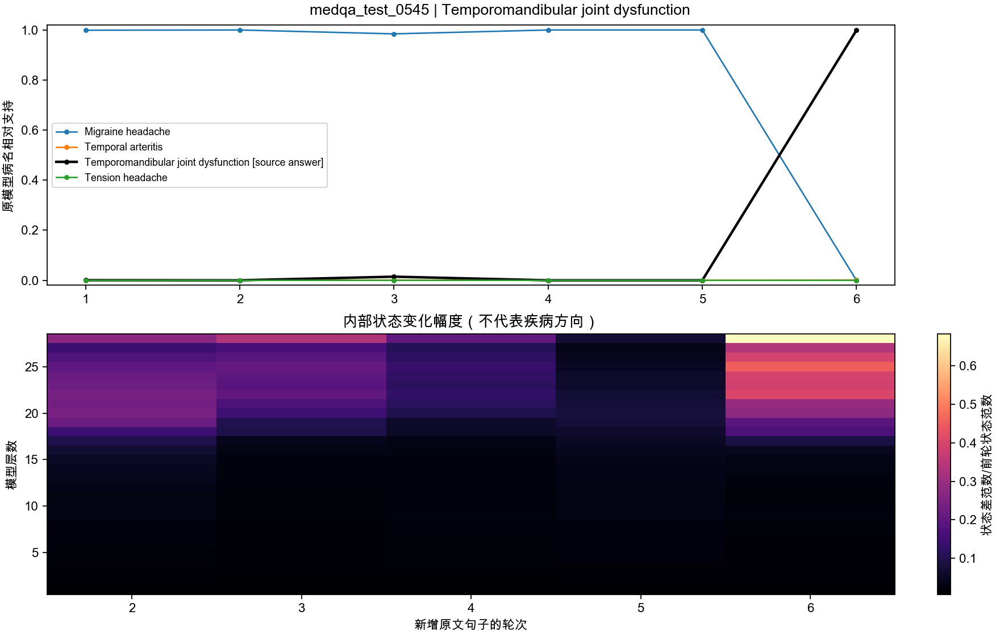

# medqa_test_0545：Temporomandibular joint dysfunction

来源：MedQA四选项test，第545行（零起始）。来源答案只用于完整题目评价。路径：转向来源病后保持。下图没有用DDxPlus探针解码MedQA病名。

Which of the following is the most likely diagnosis?

| 轮 | 原模型首选 | 来源答案支持 | 本轮新增原文 |
|---|---|---:|---|
| 1 | Migraine headache | 0.0005 | A 24-year-old woman presents to the emergency department with a severe headache. |
| 2 | Migraine headache | 0.0000 | She states it is 10/10 in intensity and states that it is associated with chewing. |
| 3 | Migraine headache | 0.0145 | She describes it as a dull pain over the sides of her head. |
| 4 | Migraine headache | 0.0000 | The patient is otherwise healthy and is not currently taking any medications. |
| 5 | Migraine headache | 0.0000 | Her temperature is 97.0°F (36.4°C), blood pressure is 111/74 mmHg, pulse is 83/min, respirations are 13/min, and oxygen saturation is 98% on room air. |
| 6 | Temporomandibular joint dysfunction | 0.9989 | Physical exam is notable for pain and tenderness over the mandibular and temporal region that is worsened when the patient opens and closes their mouth. |

| 完整题目控制 | 原模型首选 | 来源答案支持改变 |
|---|---|---:|
| reverse | Temporomandibular joint dysfunction | -0.0013 |
| shuffle | Temporomandibular joint dysfunction | -0.0012 |
| wrong_history | Temporomandibular joint dysfunction | -0.0003 |

原题选项：{"A": "Migraine headache", "B": "Temporal arteritis", "C": "Temporomandibular joint dysfunction", "D": "Tension headache"}
