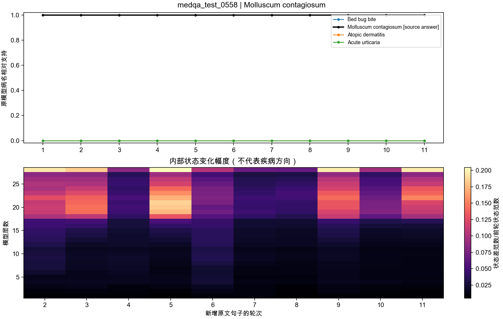

# medqa_test_0558：Molluscum contagiosum

来源：MedQA四选项test，第558行（零起始）。来源答案只用于完整题目评价。路径：始终首选来源病。下图没有用DDxPlus探针解码MedQA病名。

Which of the following is the most likely diagnosis?

| 轮 | 原模型首选 | 来源答案支持 | 本轮新增原文 |
|---|---|---:|---|
| 1 | Molluscum contagiosum | 1.0000 | A 44-year-old man presents to the family medicine clinic for some small bumps on his left thigh. |
| 2 | Molluscum contagiosum | 1.0000 | The lesions are non-pruritic and have been present for the last 3 weeks. |
| 3 | Molluscum contagiosum | 1.0000 | He reports feeling fatigued and malaise for the past few months. |
| 4 | Molluscum contagiosum | 1.0000 | The patient has no known medical problems and takes no medications. |
| 5 | Molluscum contagiosum | 1.0000 | He smokes one pack of cigarettes per day and uses intravenous street drugs. |
| 6 | Molluscum contagiosum | 1.0000 | His heart rate is 82/min, the respiratory rate is 14/min, the temperature is 36.7°C (98.1°F), and the blood pressure is 126/80 mm Hg. |
| 7 | Molluscum contagiosum | 1.0000 | Auscultation of the heart is without murmurs. |
| 8 | Molluscum contagiosum | 1.0000 | Lungs are clear to auscultation bilaterally. |
| 9 | Molluscum contagiosum | 1.0000 | Three 2-3 mm, dome-shaped, hardened papules are noted on the left thigh. |
| 10 | Molluscum contagiosum | 1.0000 | Central umbilication can be observed in each papule. |
| 11 | Molluscum contagiosum | 1.0000 | There is a non-tender cervical lymphadenopathy present. |

| 完整题目控制 | 原模型首选 | 来源答案支持改变 |
|---|---|---:|
| reverse | Molluscum contagiosum | +0.0000 |
| shuffle | Molluscum contagiosum | +0.0000 |
| wrong_history | Atopic dermatitis | -1.0000 |

原题选项：{"A": "Bed bug bite", "B": "Molluscum contagiosum", "C": "Atopic dermatitis", "D": "Acute urticaria"}
