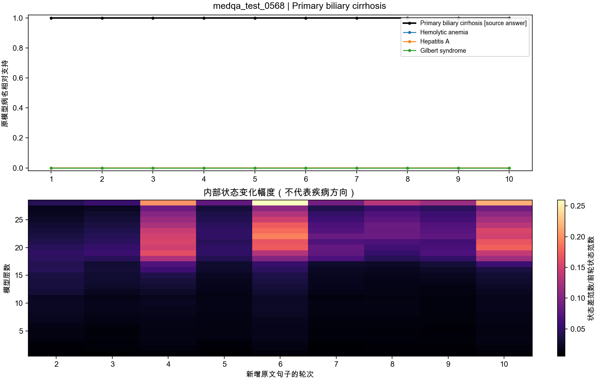

# medqa_test_0568：Primary biliary cirrhosis

来源：MedQA四选项test，第568行（零起始）。来源答案只用于完整题目评价。路径：始终首选来源病。下图没有用DDxPlus探针解码MedQA病名。

Which of the following is the most likely diagnosis in this patient?

| 轮 | 原模型首选 | 来源答案支持 | 本轮新增原文 |
|---|---|---:|---|
| 1 | Primary biliary cirrhosis | 1.0000 | A 55-year-old woman presents with severe pruritus and fatigue. |
| 2 | Primary biliary cirrhosis | 1.0000 | She denies any similar symptoms in the past. |
| 3 | Primary biliary cirrhosis | 1.0000 | No significant past medical history. |
| 4 | Primary biliary cirrhosis | 1.0000 | Upon physical examination, scleral icterus is present, and significant hepatosplenomegaly is noted. |
| 5 | Primary biliary cirrhosis | 1.0000 | Mild peripheral edema is also present. |
| 6 | Primary biliary cirrhosis | 0.9999 | Laboratory findings are significant for elevated serum levels of bilirubin, aminotransferases, alkaline phosphatase (ALP), γ-glutamyl transpeptidase (GGTP), immunoglobulins, as well as cholesterol (especially HDL fraction). |
| 7 | Primary biliary cirrhosis | 1.0000 | Antiviral antibodies are not present. |
| 8 | Primary biliary cirrhosis | 1.0000 | The erythrocyte sedimentation rate is also elevated. |
| 9 | Primary biliary cirrhosis | 1.0000 | Anti-mitochondrial antibodies are found. |
| 10 | Primary biliary cirrhosis | 1.0000 | A liver biopsy is performed, and the histopathologic examination shows bile duct injury, cholestasis, and granuloma formation. |

| 完整题目控制 | 原模型首选 | 来源答案支持改变 |
|---|---|---:|
| reverse | Primary biliary cirrhosis | +0.0000 |
| shuffle | Primary biliary cirrhosis | -0.0000 |
| wrong_history | Primary biliary cirrhosis | -0.0000 |

原题选项：{"A": "Primary biliary cirrhosis", "B": "Hemolytic anemia", "C": "Hepatitis A", "D": "Gilbert syndrome"}
