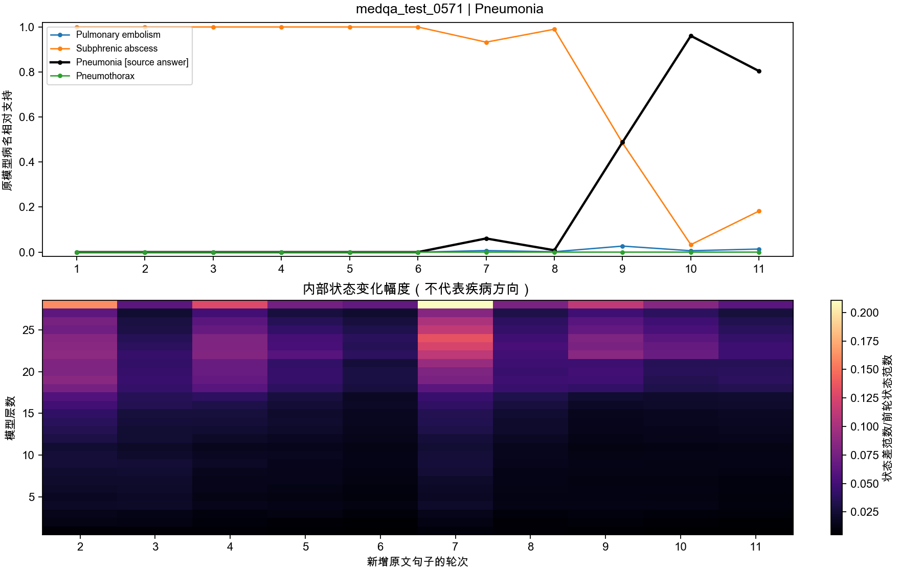

# medqa_test_0571：Pneumonia

来源：MedQA四选项test，第571行（零起始）。来源答案只用于完整题目评价。路径：转向来源病后保持。下图没有用DDxPlus探针解码MedQA病名。

Which of the following is the most likely diagnosis?

| 轮 | 原模型首选 | 来源答案支持 | 本轮新增原文 |
|---|---|---:|---|
| 1 | Subphrenic abscess | 0.0000 | Three days after undergoing an open cholecystectomy, an obese 57-year-old woman has fever, chills, and a headache. |
| 2 | Subphrenic abscess | 0.0000 | She has right-sided chest pain that increases on inspiration and has had a productive cough for the last 12 hours. |
| 3 | Subphrenic abscess | 0.0000 | She had an episode of hypotension after the operation that resolved with intravenous fluid therapy. |
| 4 | Subphrenic abscess | 0.0000 | She underwent an abdominal hysterectomy 16 years ago for multiple fibroids of the uterus. |
| 5 | Subphrenic abscess | 0.0000 | She has smoked one pack of cigarettes daily for 17 years. |
| 6 | Subphrenic abscess | 0.0000 | She appears uncomfortable. |
| 7 | Subphrenic abscess | 0.0607 | Her temperature is 39°C (102.2°F), pulse is 98/min, respirations are 18/min, and blood pressure is 128/82 mm Hg. |
| 8 | Subphrenic abscess | 0.0082 | Inspiratory crackles are heard at the right lung base. |
| 9 | Pneumonia | 0.4887 | The abdomen is soft and nontender. |
| 10 | Pneumonia | 0.9607 | There is a healing surgical incision below the right ribcage. |
| 11 | Pneumonia | 0.8039 | The remainder of the examination shows no abnormalities. |

| 完整题目控制 | 原模型首选 | 来源答案支持改变 |
|---|---|---:|
| reverse | Pneumonia | +0.1916 |
| shuffle | Pneumonia | +0.0786 |
| wrong_history | Subphrenic abscess | -0.8039 |

原题选项：{"A": "Pulmonary embolism", "B": "Subphrenic abscess", "C": "Pneumonia", "D": "Pneumothorax"}
