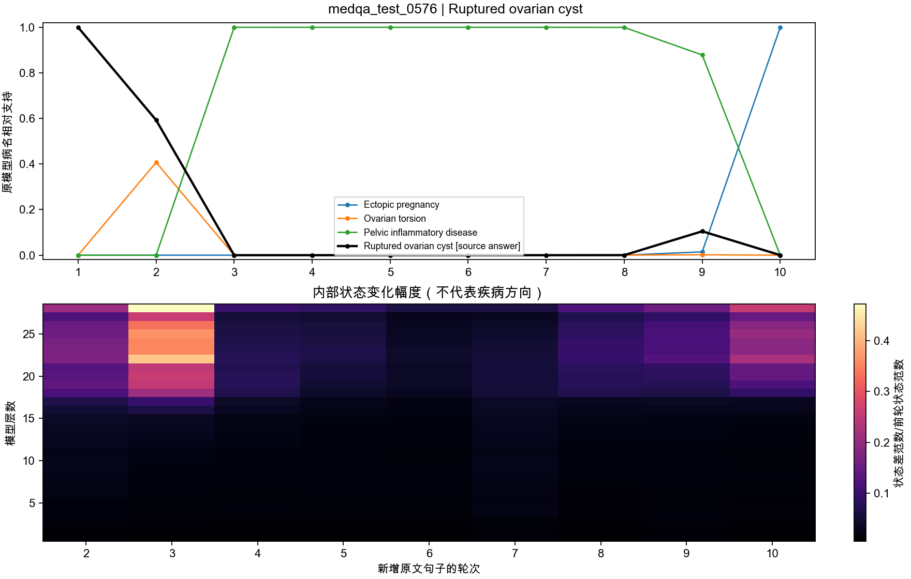

# medqa_test_0576：Ruptured ovarian cyst

来源：MedQA四选项test，第576行（零起始）。来源答案只用于完整题目评价。路径：曾选来源病，最后离开。下图没有用DDxPlus探针解码MedQA病名。

Which of the following is the most likely diagnosis?

| 轮 | 原模型首选 | 来源答案支持 | 本轮新增原文 |
|---|---|---:|---|
| 1 | Ruptured ovarian cyst | 0.9998 | A 32-year-old female is brought to the emergency room by her friend for acute onset abdominal pain. |
| 2 | Ruptured ovarian cyst | 0.5927 | She states that she was in a kickboxing class when she suddenly developed left-sided abdominal pain. |
| 3 | Pelvic inflammatory disease | 0.0000 | Her past medical history is significant for chlamydia. |
| 4 | Pelvic inflammatory disease | 0.0000 | She is currently sexually active and does not use contraception. |
| 5 | Pelvic inflammatory disease | 0.0000 | Her menstrual periods occur regularly every 30 days. |
| 6 | Pelvic inflammatory disease | 0.0000 | Her last menstrual period ended 2 days ago. |
| 7 | Pelvic inflammatory disease | 0.0000 | The patient’s temperature is 99°F (37.2°C), blood pressure is 110/68 mmHg, pulse is 88/min, and respirations are 14/min with an oxygen saturation of 98% on room air. |
| 8 | Pelvic inflammatory disease | 0.0002 | On physical exam, there is left-sided, lower abdominal tenderness and guarding. |
| 9 | Pelvic inflammatory disease | 0.1049 | Pelvic examination is notable for clear mucous in the vaginal introitus and tenderness of the left adnexa. |
| 10 | Ectopic pregnancy | 0.0002 | A pelvic ultrasound with Doppler reveals a large amount of fluid in the rectouterine pouch. |

| 完整题目控制 | 原模型首选 | 来源答案支持改变 |
|---|---|---:|
| reverse | Ectopic pregnancy | +0.0206 |
| shuffle | Ectopic pregnancy | +0.0014 |
| wrong_history | Ectopic pregnancy | -0.0002 |

原题选项：{"A": "Ectopic pregnancy", "B": "Ovarian torsion", "C": "Pelvic inflammatory disease", "D": "Ruptured ovarian cyst"}
