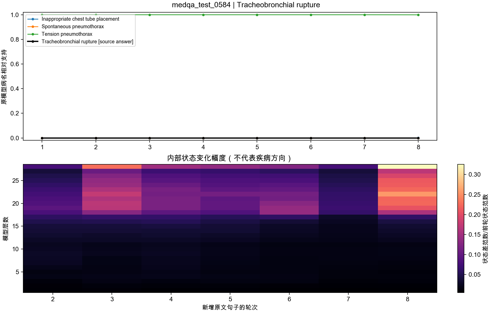

# medqa_test_0584：Tracheobronchial rupture

来源：MedQA四选项test，第584行（零起始）。来源答案只用于完整题目评价。路径：始终固定另一病。下图没有用DDxPlus探针解码MedQA病名。

Which of the following is the most likely diagnosis?

| 轮 | 原模型首选 | 来源答案支持 | 本轮新增原文 |
|---|---|---:|---|
| 1 | Tension pneumothorax | 0.0000 | A 33-year-old man presents to the emergency department after a motor vehicle collision. |
| 2 | Tension pneumothorax | 0.0000 | He was the front seat unrestrained driver in a head-on collision. |
| 3 | Tension pneumothorax | 0.0000 | The patient has a Glasgow Coma Scale of 5 and is subsequently intubated. |
| 4 | Tension pneumothorax | 0.0000 | Physical exam is notable for subcutaneous emphysema in the clavicular area. |
| 5 | Tension pneumothorax | 0.0000 | Needle decompression and chest tube placement are performed, and the patient is stabilized after receiving 2 units of blood and 2 liters of fluid. |
| 6 | Tension pneumothorax | 0.0000 | Chest radiography demonstrates proper tube location and resolution of the pneumothorax. |
| 7 | Tension pneumothorax | 0.0000 | The patient is transferred to the trauma intensive care unit. |
| 8 | Tension pneumothorax | 0.0000 | On the unit, a repeat chest radiograph is notable for a recurrent pneumothorax with the chest tube in place. |

| 完整题目控制 | 原模型首选 | 来源答案支持改变 |
|---|---|---:|
| reverse | Tension pneumothorax | -0.0000 |
| shuffle | Tension pneumothorax | -0.0000 |
| wrong_history | Tension pneumothorax | -0.0000 |

原题选项：{"A": "Inappropriate chest tube placement", "B": "Spontaneous pneumothorax", "C": "Tension pneumothorax", "D": "Tracheobronchial rupture"}
