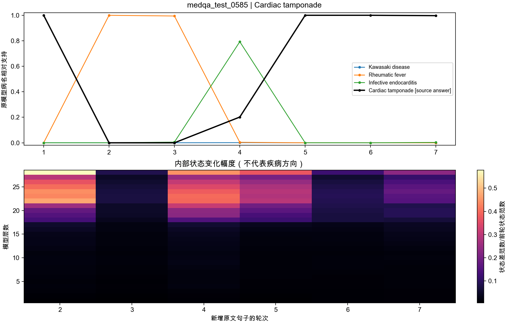

# medqa_test_0585：Cardiac tamponade

来源：MedQA四选项test，第585行（零起始）。来源答案只用于完整题目评价。路径：曾离开来源病，最后回来。下图没有用DDxPlus探针解码MedQA病名。

Which of the following is the most likely diagnosis?

| 轮 | 原模型首选 | 来源答案支持 | 本轮新增原文 |
|---|---|---:|---|
| 1 | Cardiac tamponade | 1.0000 | A 55-year-old man is brought to the emergency department 12 hours after the sudden onset of shortness of breath and substernal chest pain at rest; the pain is increased by inspiration. |
| 2 | Rheumatic fever | 0.0000 | He has also had a nonproductive cough, fever, and malaise for the past 5 days. |
| 3 | Rheumatic fever | 0.0000 | He does not smoke or use illicit drugs. |
| 4 | Infective endocarditis | 0.2019 | His temperature is 38°C (100.4°F), pulse is 125/min, respirations are 32/min, and blood pressure is 85/45 mm Hg. |
| 5 | Cardiac tamponade | 1.0000 | Physical examination shows distended neck veins. |
| 6 | Cardiac tamponade | 1.0000 | Auscultation of the chest discloses bilateral basilar rales and muffled heart sounds. |
| 7 | Cardiac tamponade | 0.9970 | An ECG shows sinus tachycardia, diffuse ST segment elevation, low voltage QRS complexes, and fluctuating R wave amplitude. |

| 完整题目控制 | 原模型首选 | 来源答案支持改变 |
|---|---|---:|
| reverse | Cardiac tamponade | +0.0030 |
| shuffle | Infective endocarditis | -0.9953 |
| wrong_history | Infective endocarditis | -0.9970 |

原题选项：{"A": "Kawasaki disease", "B": "Rheumatic fever", "C": "Infective endocarditis", "D": "Cardiac tamponade"}
