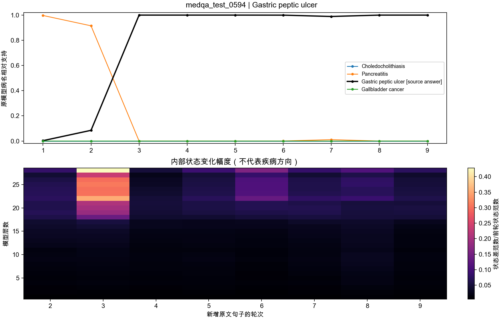

# medqa_test_0594：Gastric peptic ulcer

来源：MedQA四选项test，第594行（零起始）。来源答案只用于完整题目评价。路径：转向来源病后保持。下图没有用DDxPlus探针解码MedQA病名。

Which of the following is the most likely diagnosis?

| 轮 | 原模型首选 | 来源答案支持 | 本轮新增原文 |
|---|---|---:|---|
| 1 | Pancreatitis | 0.0030 | A 38-year-old woman presents to an urgent care clinic with the complaint of epigastric discomfort and cramping pain for the past 2 hours. |
| 2 | Pancreatitis | 0.0851 | She states that she has experienced similar pain in the past. |
| 3 | Gastric peptic ulcer | 1.0000 | These episodes occur mostly after meals and often subside several hours after she finishes eating. |
| 4 | Gastric peptic ulcer | 1.0000 | Due to this reason she mostly avoids eating. |
| 5 | Gastric peptic ulcer | 1.0000 | She says she has lost a few pounds in the last couple of months. |
| 6 | Gastric peptic ulcer | 0.9996 | She is a smoker and drinks alcohol occasionally. |
| 7 | Gastric peptic ulcer | 0.9890 | Past medical history is insignificant except for chronic knee pain, for which she takes over the counter painkillers. |
| 8 | Gastric peptic ulcer | 0.9999 | Her temperature is 37°C (98.6°F), respiratory rate is 16/min, pulse is 77/min, and blood pressure is 120/89 mm Hg. |
| 9 | Gastric peptic ulcer | 1.0000 | A physical abdominal exam is unremarkable, including examination of the abdomen. |

| 完整题目控制 | 原模型首选 | 来源答案支持改变 |
|---|---|---:|
| reverse | Pancreatitis | -0.8741 |
| shuffle | Pancreatitis | -0.9937 |
| wrong_history | Pancreatitis | -1.0000 |

原题选项：{"A": "Choledocholithiasis", "B": "Pancreatitis", "C": "Gastric peptic ulcer", "D": "Gallbladder cancer"}
