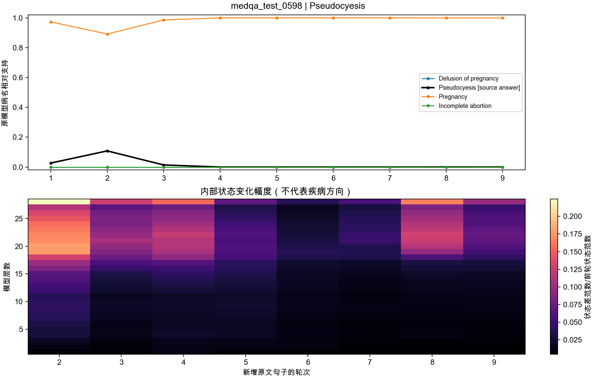

# medqa_test_0598：Pseudocyesis

来源：MedQA四选项test，第598行（零起始）。来源答案只用于完整题目评价。路径：始终固定另一病。下图没有用DDxPlus探针解码MedQA病名。

Which of the following is the most likely diagnosis?

| 轮 | 原模型首选 | 来源答案支持 | 本轮新增原文 |
|---|---|---:|---|
| 1 | Pregnancy | 0.0268 | A 34-year-old woman comes to the physician requesting prenatal care. |
| 2 | Pregnancy | 0.1082 | For the past 2 months, she has had increasing breast tenderness, nausea, 3-kg (6.6-lb) weight gain, and urinary frequency. |
| 3 | Pregnancy | 0.0138 | She is not sure about the date of her last menstrual period. |
| 4 | Pregnancy | 0.0001 | She has been trying to conceive with her husband since she stopped taking oral contraceptives 6 months ago; she was happy to tell him last week that she is pregnant. |
| 5 | Pregnancy | 0.0000 | Her temperature is 37.2°C (99°F), pulse is 100/min, and blood pressure is 110/60 mm Hg. |
| 6 | Pregnancy | 0.0000 | Physical examination shows mild, nontender abdominal enlargement. |
| 7 | Pregnancy | 0.0000 | The cervical os is closed. |
| 8 | Pregnancy | 0.0002 | Urine β-hCG is negative. |
| 9 | Pregnancy | 0.0001 | Transvaginal ultrasonography shows no abnormalities. |

| 完整题目控制 | 原模型首选 | 来源答案支持改变 |
|---|---|---:|
| reverse | Pregnancy | +0.0004 |
| shuffle | Pregnancy | +0.0035 |
| wrong_history | Pregnancy | +0.0033 |

原题选项：{"A": "Delusion of pregnancy", "B": "Pseudocyesis", "C": "Pregnancy", "D": "Incomplete abortion"}
