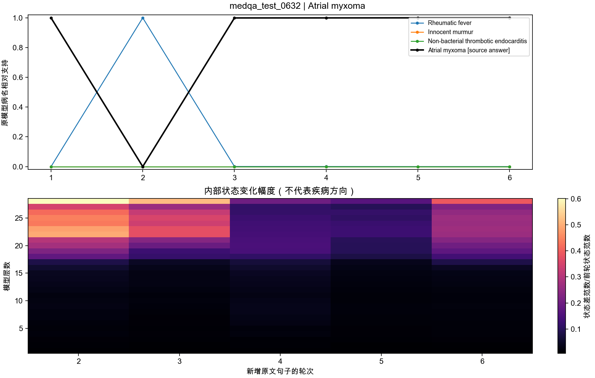

# medqa_test_0632：Atrial myxoma

来源：MedQA四选项test，第632行（零起始）。来源答案只用于完整题目评价。路径：曾离开来源病，最后回来。下图没有用DDxPlus探针解码MedQA病名。

Which of the following is the most likely diagnosis?

| 轮 | 原模型首选 | 来源答案支持 | 本轮新增原文 |
|---|---|---:|---|
| 1 | Atrial myxoma | 1.0000 | A 41-year-old woman presents with shortness of breath that is worse when she lies on her left side. |
| 2 | Rheumatic fever | 0.0000 | About 10 days ago, she had an episode of unexplained loss of consciousness. |
| 3 | Atrial myxoma | 0.9992 | Past medical history is negative and family history is irrelevant. |
| 4 | Atrial myxoma | 0.9995 | Clinical examination shows a diastolic murmur, which is prominent when she lies on her left side. |
| 5 | Atrial myxoma | 1.0000 | Jugular venous distention is present, and chest examination reveals fine crackles that do not clear with coughing. |
| 6 | Atrial myxoma | 1.0000 | Chest X-ray shows pulmonary congestion, and 2-dimensional echocardiogram shows a mass in the left atrium attached to the atrial septum. |

| 完整题目控制 | 原模型首选 | 来源答案支持改变 |
|---|---|---:|
| reverse | Atrial myxoma | -0.0000 |
| shuffle | Atrial myxoma | -0.0000 |
| wrong_history | Non-bacterial thrombotic endocarditis | -1.0000 |

原题选项：{"A": "Rheumatic fever", "B": "Innocent murmur", "C": "Non-bacterial thrombotic endocarditis", "D": "Atrial myxoma"}
