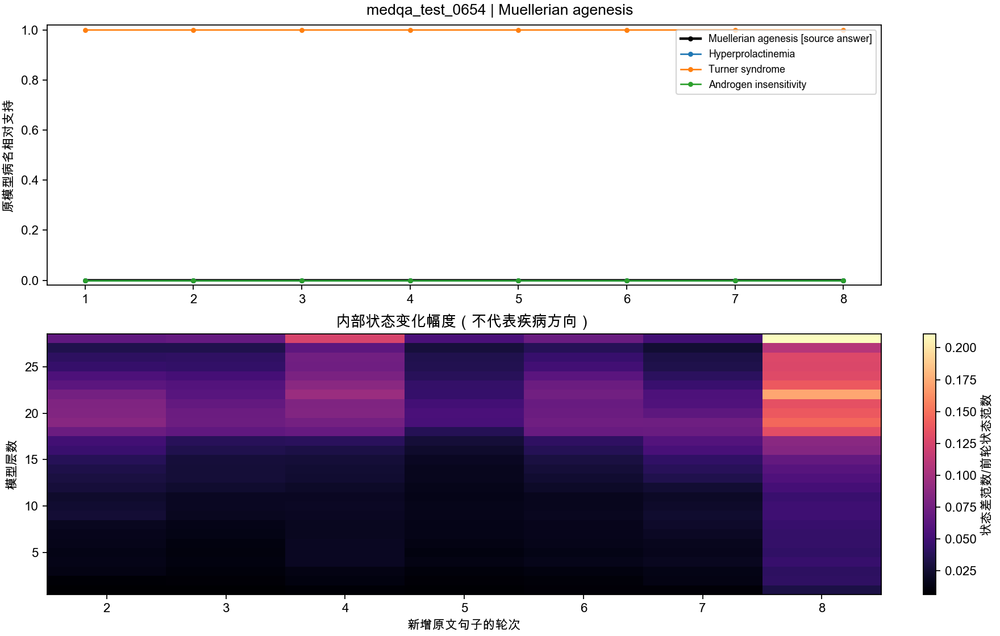

# medqa_test_0654：Muellerian agenesis

来源：MedQA四选项test，第654行（零起始）。来源答案只用于完整题目评价。路径：始终固定另一病。下图没有用DDxPlus探针解码MedQA病名。

What is the most likely diagnosis of this patient?

| 轮 | 原模型首选 | 来源答案支持 | 本轮新增原文 |
|---|---|---:|---|
| 1 | Turner syndrome | 0.0000 | A mother brings her 18-year-old daughter to your office because she has not menstruated yet. |
| 2 | Turner syndrome | 0.0000 | They recently immigrated from another country, and do not have any previous medical records. |
| 3 | Turner syndrome | 0.0000 | The adolescent girl looks relatively short, but otherwise looks healthy. |
| 4 | Turner syndrome | 0.0000 | She has no complaints except for mild intermittent lower abdominal pain for the past year. |
| 5 | Turner syndrome | 0.0000 | On physical examination, vitals are within normal limits. |
| 6 | Turner syndrome | 0.0000 | There is the presence of axillary hair, breast development, and pubic hair at Tanner stage 5. |
| 7 | Turner syndrome | 0.0000 | You explain to the mother and the patient that you need to perform a complete vaginal examination, however, both of them declined the procedure and would prefer that lab test be performed. |
| 8 | Turner syndrome | 0.0001 | Her labs are significant for the following:
FSH 7 mIU/mL
Normal values:  
   Follicular phase 3.1 – 7.9 mIU/mL
   Ovulation peak 2.3 – 18.5 mIU/mL
   Luteal phase 1.4 – 5.5 mIU/mL
   Postmenopausal 30.6 – 106.3 mIU/mL
Estradiol 28 pg/mL
Normal values:  
   Mid-follicular phase 27 – 123 pg/mL
   Periovulatory 96 – 436 pg/mL
   Mid-luteal phase 49 – 294 pg/mL
   Postmenopausal 0 – 40 pg/mL
Testosterone 52 ng/dL, 40 – 60 ng/dL |

| 完整题目控制 | 原模型首选 | 来源答案支持改变 |
|---|---|---:|
| reverse | Turner syndrome | -0.0001 |
| shuffle | Turner syndrome | -0.0001 |
| wrong_history | Turner syndrome | -0.0001 |

原题选项：{"A": "Muellerian agenesis", "B": "Hyperprolactinemia", "C": "Turner syndrome", "D": "Androgen insensitivity"}
