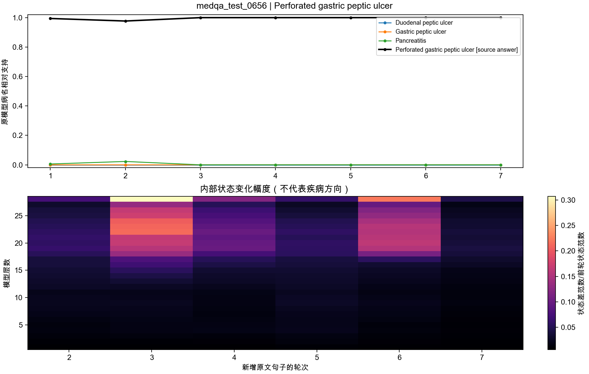

# medqa_test_0656：Perforated gastric peptic ulcer

来源：MedQA四选项test，第656行（零起始）。来源答案只用于完整题目评价。路径：始终首选来源病。下图没有用DDxPlus探针解码MedQA病名。

Which of the following is the most likely diagnosis?

| 轮 | 原模型首选 | 来源答案支持 | 本轮新增原文 |
|---|---|---:|---|
| 1 | Perforated gastric peptic ulcer | 0.9943 | A 55-year-old man is brought to the emergency room by his wife for severe abdominal pain for the past 1 hour. |
| 2 | Perforated gastric peptic ulcer | 0.9770 | He is unable to give more information about the nature of his pain. |
| 3 | Perforated gastric peptic ulcer | 1.0000 | His wife says that he has peptic ulcer disease and is being treated with antacids without a good response. |
| 4 | Perforated gastric peptic ulcer | 1.0000 | She adds that he vomited repeatedly  in the last couple of hours, his vomitus being brown/red in color. |
| 5 | Perforated gastric peptic ulcer | 1.0000 | His temperature is 98.6°F (37°C), respiratory rate is 16/min, pulse is 97/min, and blood pressure is 100/68 mm Hg. |
| 6 | Perforated gastric peptic ulcer | 1.0000 | A physical exam reveals a tense abdomen with a board like rigidity and positive rebound tenderness. |
| 7 | Perforated gastric peptic ulcer | 1.0000 | An erect abdominal x-ray is ordered. |

| 完整题目控制 | 原模型首选 | 来源答案支持改变 |
|---|---|---:|
| reverse | Perforated gastric peptic ulcer | -0.0000 |
| shuffle | Perforated gastric peptic ulcer | -0.0000 |
| wrong_history | Perforated gastric peptic ulcer | -0.0000 |

原题选项：{"A": "Duodenal peptic ulcer", "B": "Gastric peptic ulcer", "C": "Pancreatitis", "D": "Perforated gastric peptic ulcer"}
