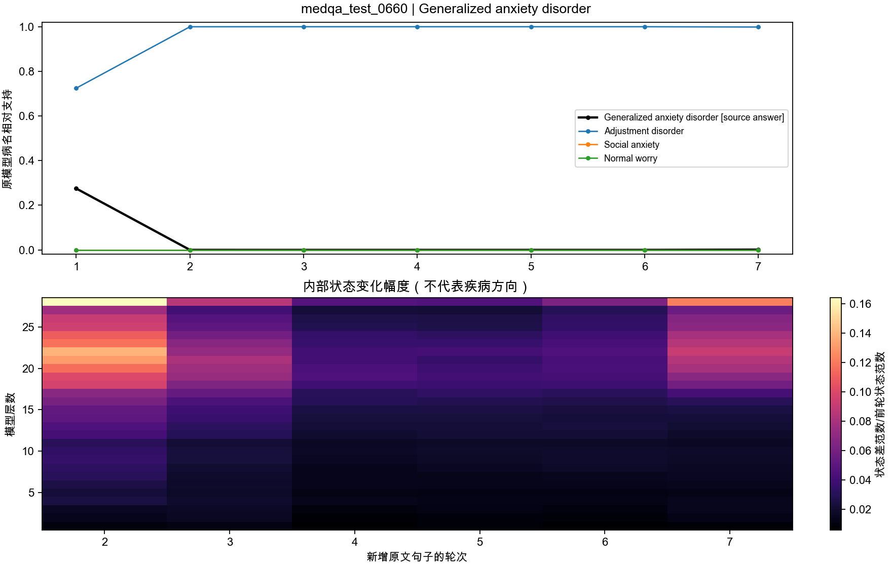

# medqa_test_0660：Generalized anxiety disorder

来源：MedQA四选项test，第660行（零起始）。来源答案只用于完整题目评价。路径：始终固定另一病。下图没有用DDxPlus探针解码MedQA病名。

Which of the following is the most likely diagnosis in this patient?

| 轮 | 原模型首选 | 来源答案支持 | 本轮新增原文 |
|---|---|---:|---|
| 1 | Adjustment disorder | 0.2751 | A 35-year-old man presents with a 7 month history of insomnia. |
| 2 | Adjustment disorder | 0.0001 | The patient admitted to having trouble sleeping from a young age but became more aware of how much this is affecting his health after attending a sleep conference earlier this year. |
| 3 | Adjustment disorder | 0.0000 | He is worried that his health has suffered because of this, and he is also concerned that he will not be able to pay his bills if he were to get sick. |
| 4 | Adjustment disorder | 0.0000 | He has no past medical or psychiatric condition and is not known to use any recreational drugs. |
| 5 | Adjustment disorder | 0.0000 | The patient arrived for his appointment an hour early because he was afraid he might miss it. |
| 6 | Adjustment disorder | 0.0000 | The patient is afebrile and his vital signs are within normal limits. |
| 7 | Adjustment disorder | 0.0013 | Physical examination reveals an irritable middle age man who is tense and somewhat inattentive during the interview. |

| 完整题目控制 | 原模型首选 | 来源答案支持改变 |
|---|---|---:|
| reverse | Adjustment disorder | -0.0013 |
| shuffle | Adjustment disorder | -0.0013 |
| wrong_history | Adjustment disorder | -0.0013 |

原题选项：{"A": "Generalized anxiety disorder", "B": "Adjustment disorder", "C": "Social anxiety ", "D": "Normal worry"}
